# Cloud Based Active Directory Setup and User Management in Azure

## Overview

The goal was to build an Active Directory environment where a user could sign in from a separate Azure VM and communicate with the domain controller. DC01 hosted Active Directory Domain Services and DNS, while CLIENT01 provided the machine for testing domain membership and user access.

Setup involved checking the client’s DNS configuration, verifying the administrator’s domain account context, and troubleshooting Alice’s remote login. The DNS checks clarified the difference between the client’s private address and the controller’s DNS address. Alice’s login troubleshooting included resetting her password, adjusting the password change requirement, and granting Remote Desktop access on the client.

The final session returned corp\alice from whoami, and a ping to DC01 received four replies with no packet loss. The main lesson was to verify network configuration, account identity, and access permissions separately, using each result to confirm a specific part of the setup.

## Tools and Environment

The lab used Microsoft Azure for infrastructure and Windows Server tools for domain configuration, account management, and verification.

| Component | Lab configuration |
| --- | --- |
| Resource group | `AD_Lab` in West US 3 |
| Virtual network | `AD-VNet` with the default subnet |
| Domain controller | `DC01`, Windows Server 2022, private IP `10.0.0.4` |
| Domain member | Windows computer `CLIENT01`, Windows Server 2022, private IP `10.0.0.5` |
| Azure client resource name | `CILENT01`, as entered during VM creation |
| VM size | `Standard_B2als_v2`, 2 vCPUs and 4 GiB memory |
| Domain | `corp.local` |
| Test OU | `TestUsers` |
| Test accounts | Alice, Bob, and Charlie |

Configuration and testing tools included Server Manager, Active Directory Users and Computers, DNS Manager, Remote Desktop, Command Prompt, and Event Viewer.

The client's Azure resource name was entered as CILENT01, while its Windows computer name was CLIENT01. Both names appear in the screenshots.

## Build and Configuration

### Step 1 Create the Azure lab

Created the resource group and virtual network, then deployed two VMs in West US 3. One machine hosted domain services, while the other provided a separate place to test user access.

Keeping both machines on the same virtual network allowed communication through their private addresses. The B2als_v2 size was selected for its affordability and resources suitable for a small lab. Performance under a larger workload was outside the testing completed here.

RDP was enabled during deployment. The domain controller's inbound RDP rule was then restricted to the public IP used for the lab connection. This kept the connection available for setup while narrowing the permitted sources.

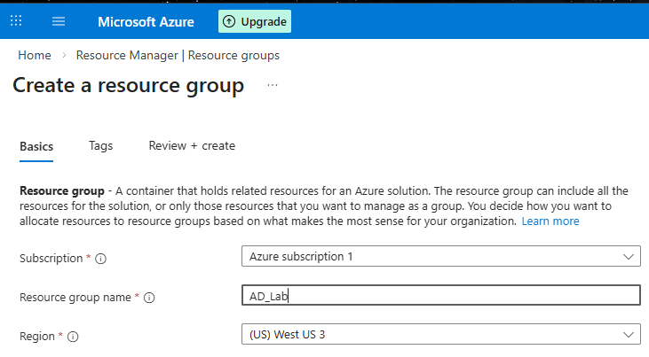

*Screenshot 1: Resource group name and region selected during setup.*

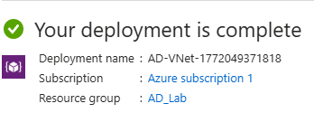

*Screenshot 2: Successful deployment of AD-VNet.*

### Step 2 Install AD DS and create the domain

Installed Active Directory Domain Services on DC01 through Server Manager, then promoted it into a new forest named `corp.local`. DNS was enabled, and the forest and domain functional levels were set to Windows Server 2016.

After the restart, checked the domain in Active Directory Users and Computers and reviewed the forward lookup zones in DNS Manager. These checks confirmed that the domain and its DNS zones were present after promotion.

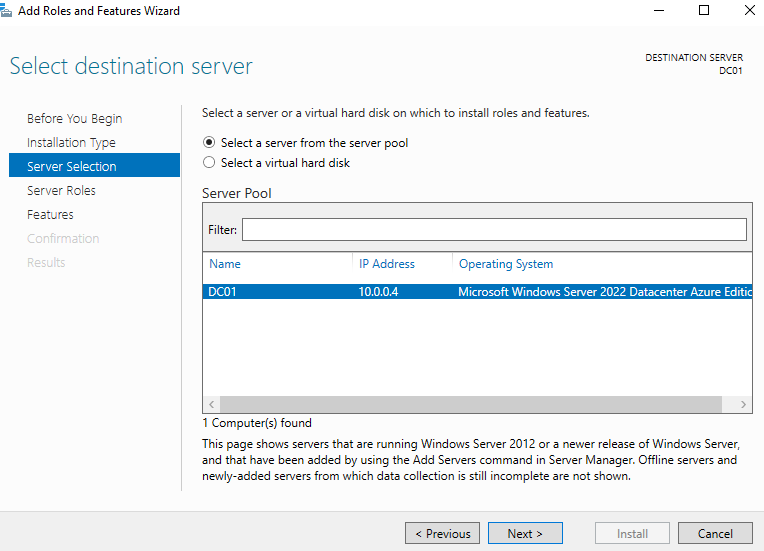

*Screenshot 3: DC01 running Windows Server 2022 with private IP 10.0.0.4.*

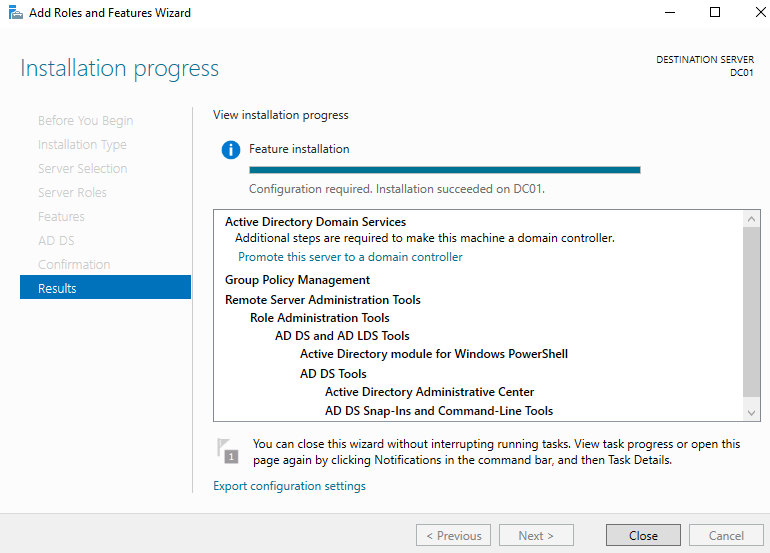

*Screenshot 4: The AD DS role installation completed before domain controller promotion.*

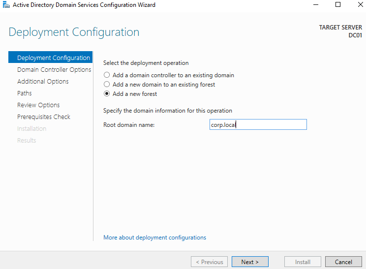

*Screenshot 5: corp.local entered as the new forest's root domain.*

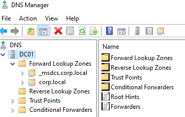

*Screenshot 6: corp.local and _msdcs.corp.local visible in DNS Manager.*

### Step 3 Configure DNS for domain discovery

Configured the virtual network's custom DNS server as `10.0.0.4`, the domain controller's private address. Restarted CLIENT01 and checked its configuration with `ipconfig /all`.

The setup required clarifying two different settings: CLIENT01 kept `10.0.0.5` as its own private address and used `10.0.0.4` for DNS. The machines needed distinct addresses, with the client using DC01 to resolve domain services.

Checking the running client after the restart verified the configuration it had received. This was more useful than relying only on the DNS setting saved in Azure.

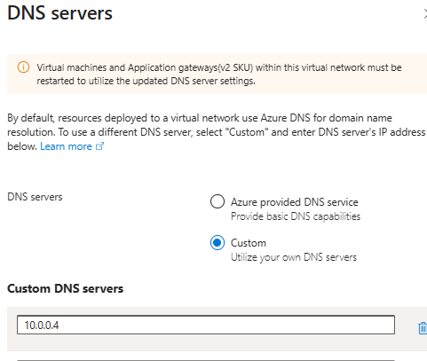

*Screenshot 7: The VNet configured to use DC01 for DNS.*

### Step 4 Join the client and verify domain identity

Joined CLIENT01 to `corp.local` using the domain administrator credentials and restarted it. The welcome message confirmed successful domain enrollment.

Account context also needed checking during sign in. A later `whoami` command returned `corp\sam_admin`, confirming that the session used a domain account.

The two checks answered different questions. The welcome message confirmed that the computer joined the domain, while whoami identified the account in the session.

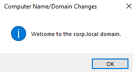

*Screenshot 8: The client accepted into the corp.local domain.*

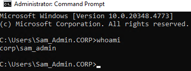

*Screenshot 9: whoami returned corp\sam_admin.*

### Step 5 Create users and test access

Created the `TestUsers` OU and the Alice, Bob, and Charlie accounts. Checked that the users belonged to Domain Users.

Alice's remote login required additional changes. Reset her password, cleared the requirement to change it at the next sign in, and added `CORP\alice` through the client's Remote Desktop Users dialog.

The remote access permission was applied on the machine Alice needed to use. Her domain account existed, but permission to start a remote session still needed to be configured.

Both password settings and remote access permissions were adjusted before the successful retest. The recorded result confirms that the combined changes worked, without isolating one change as the cause of the fix.

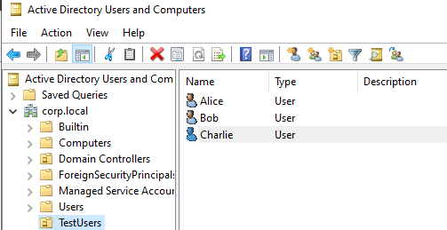

*Screenshot 10: Alice, Bob, and Charlie listed in TestUsers.*

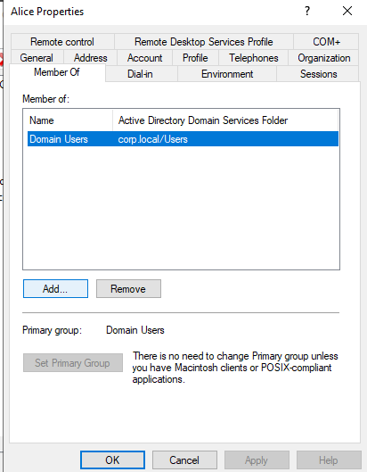

*Screenshot 11: Alice's membership in Domain Users.*

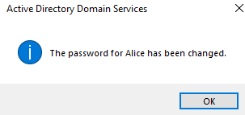

*Screenshot 12: Confirmation that Alice's password was changed.*

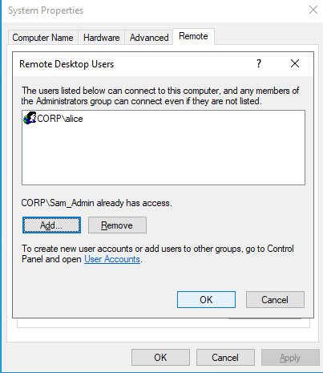

*Screenshot 13: CORP\alice listed among the client's permitted remote desktop users.*

### Step 6 Verify authentication and connectivity

Verified Alice's session with `whoami`, which returned `corp\alice`. File Explorer displayed the `netlogon` and `sysvol` shares on DC01, and a ping to the controller received four replies with no packet loss.

| Check | Recorded result | What it established |
| --- | --- | --- |
| Domain join | Welcome message for corp.local | The client joined the domain |
| Administrator identity | `corp\sam_admin` | The session used a domain administrator account |
| Alice identity | `corp\alice` | The client session used Alice's domain account |
| Domain shares | netlogon and sysvol displayed | Domain shares were visible from the client |
| Ping to `10.0.0.4` | 4 sent, 4 received, 0% loss | IP connectivity to DC01 during the test |

These checks provided evidence for separate parts of the setup. Ping confirmed reachability, while whoami confirmed the session identity.

Three test accounts were created. Alice was the account used for the documented user login test.

## Security Event Review

Filtered the Windows Security log in Event Viewer to examine authentication, account management, and group membership activity.

The review focused on what each record represented and what additional information would be needed to connect it to a specific action.

| Event ID | Meaning | Captured evidence |
| --- | --- | --- |
| 4624 | Successful logon | [View screenshot](screenshots/14-event-4624.png) |
| 4625 | Failed logon | [View screenshot](screenshots/15-event-4625.png) |
| 4648 | Logon attempt with explicitly supplied credentials | [View screenshot](screenshots/16-event-4648.png) |
| 4720 | User account created | [View screenshot](screenshots/17-event-4720.png) |
| 4722 | User account enabled | [View screenshot](screenshots/18-event-4722.png) |
| 4724 | Password reset attempt | [View screenshot](screenshots/19-event-4724.png) |
| 4725 | User account disabled | [View screenshot](screenshots/20-event-4725.png) |
| 4732 | Member added to a security enabled local group | [View screenshot](screenshots/21-event-4732.png) |
| 4735 | Security enabled local group changed | [View screenshot](screenshots/22-event-4735.png) |
| 4733 | Member removed from a security enabled local group | [View screenshot](screenshots/23-event-4733.png) |

Ten event types were captured. Some screenshots show only a heading or short excerpt, so they establish the event type without identifying every account, group, or initiating action.

The event descriptions also needed careful interpretation. A failed login alone does not establish a brute force attack, and event 4648 can occur during legitimate credential use. Events 4732 and 4733 specifically describe changes to security enabled local groups.

Complete event fields and timestamps would support stronger correlation between a recorded action and its audit entry.

## Troubleshooting and Decisions

### Clarifying the DNS configuration

The initial notes mixed the client's private address with its DNS server address. Reviewing the configuration clarified that CLIENT01 used `10.0.0.5` for its own address and DC01 at `10.0.0.4` for DNS.

The useful verification step was checking the client after the network change. This confirmed the setting in use on the machine.

### Confirming administrator account context

A credential failure was recorded after domain controller promotion. Domain account use was later confirmed through whoami.

This showed the value of checking the established session identity. A familiar username in a login window did not provide the same confirmation.

### Troubleshooting Alice's remote login

The changes addressed both password state and permission to use Remote Desktop on CLIENT01. The final identity check returned `corp\alice`.

Because several settings changed before the retest, the precise cause was not isolated. Making one change at a time would improve the troubleshooting record in a future test.

### Reviewing event context

The event review required attention to the activity described, the group scope, and the available fields. Matching an event number was the first step; interpreting its context required more detail.

The short excerpts were useful for documenting event types. Full records would make it easier to verify which account performed an action, what changed, and when it happened.

## Results and Lessons Learned

The completed lab supported domain membership and a verified user session across two Azure VMs. Three accounts were provisioned, Alice's domain identity was confirmed, and communication with DC01 succeeded during the connectivity test.

The main lesson was to separate configuration from verification. A saved setting showed what was selected, while identity checks, connectivity results, and event records provided evidence of different outcomes.

Troubleshooting also highlighted the relationship between account state and access permissions. Checking both helped resolve Alice's login problem, while the sequence of changes showed why a clearer retest process would improve future investigations.

## Future Improvements

1. Make one troubleshooting change at a time and record the result before continuing.
2. Preserve full event records and correlate a known action with its account, system, and timestamp.
3. Test a defined password and account lockout policy, including the first sign in password change process.
4. Forward selected logs to a central analysis platform for searching across both VMs.

These are proposed follow up tasks rather than completed parts of the lab.