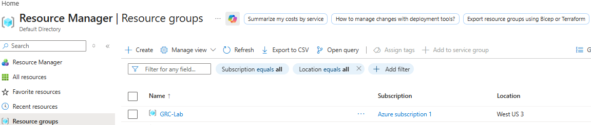
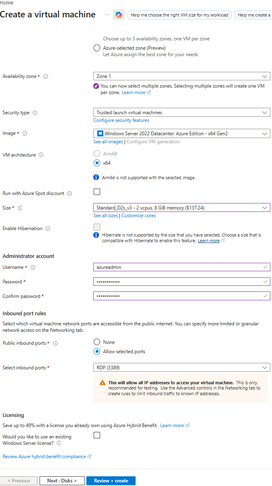
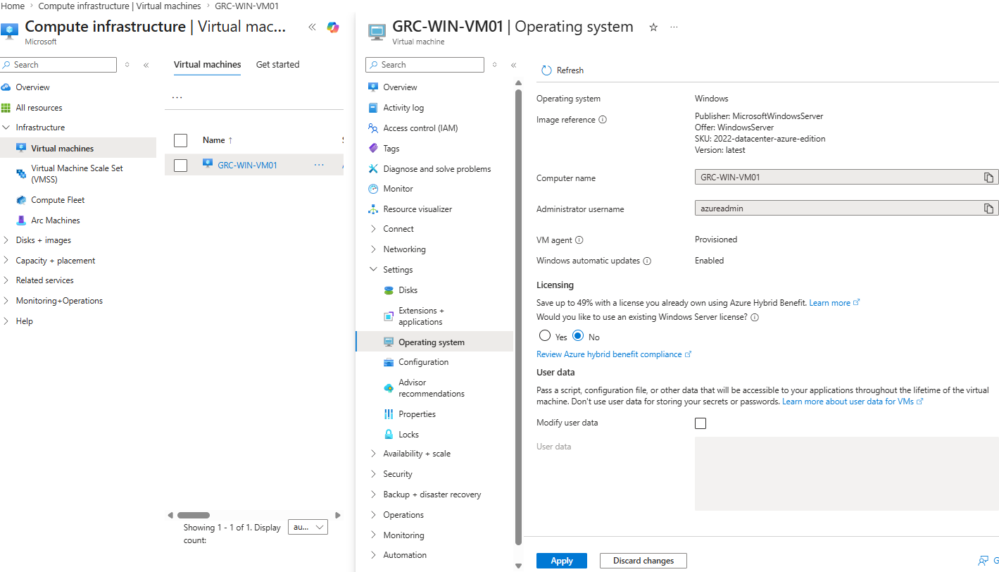
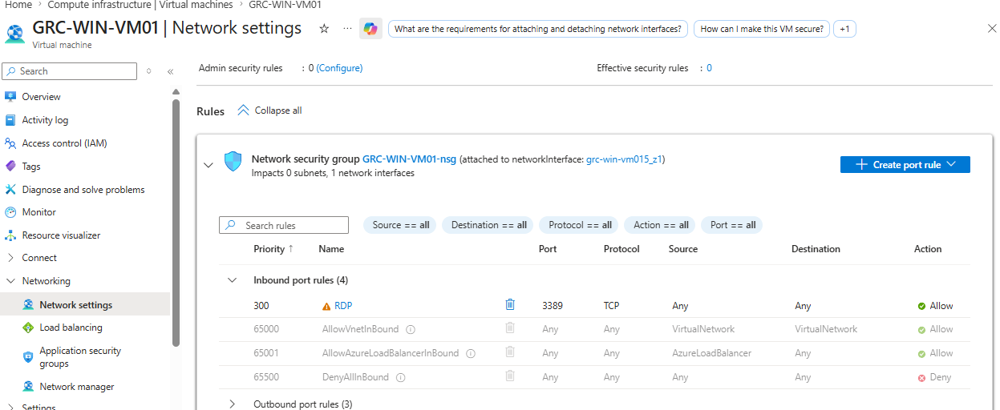
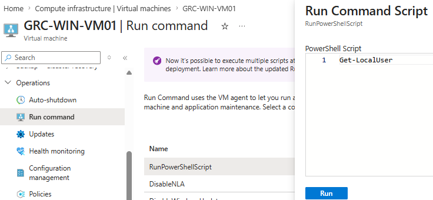
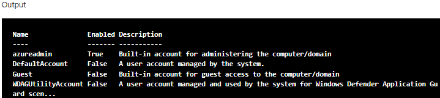
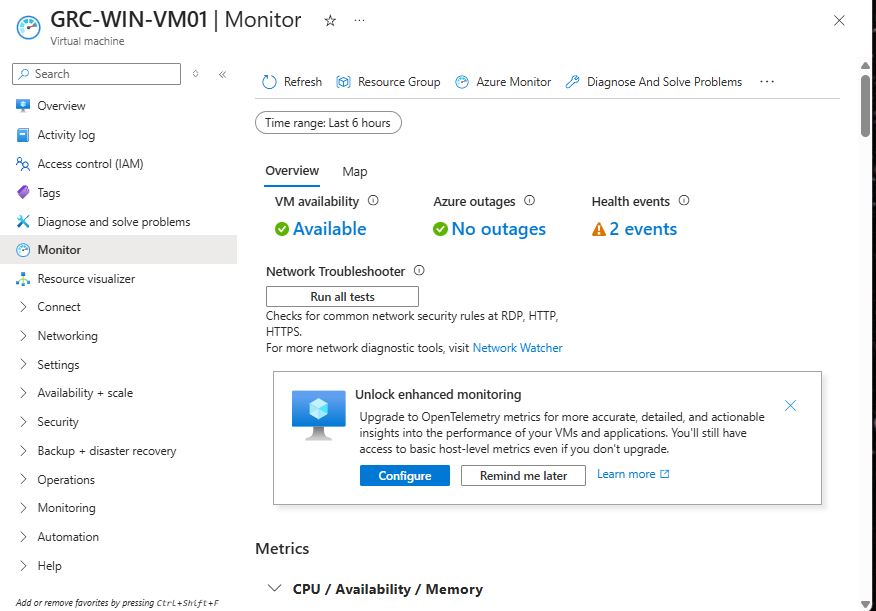
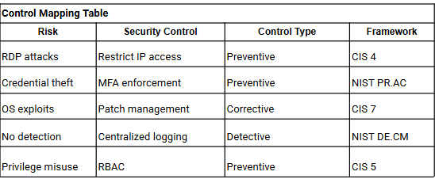

# Cloud Security Risk Assessment and GRC Simulation in Azure

## Overview

The goal was to assess the risk created by administering a Windows Server VM through internet accessible RDP. The lab's NSG allowed TCP port 3389 from any source, providing a specific configuration to examine and prioritize.

The assessment linked assets and threat scenarios to likelihood and impact scores, then recorded recommended controls in a mitigation tracker. Public RDP exposure received the highest score in the five item register.

Setup required an alternative VM size when the required size was unavailable. Network checks confirmed that the connection worked without adjustments, and account or permission changes produced reviewable events through already enabled auditing. The completed work documented the assessment and treatment recommendations.

**Project type:** Personal Azure VM lab and GRC assessment simulation.

## Tools and Environment

Microsoft Azure, Network Security Groups, Run Command, PowerShell, Computer Management, Event Viewer, and Azure VM monitoring.

| Component | Lab configuration |
| --- | --- |
| Resource group | `GRC-Lab` |
| Virtual machine | `GRC-WIN-VM01` |
| Region | West US 3 |
| Operating system | Windows Server 2022 Datacenter Azure Edition |
| VM size | `Standard_D2s_v3`, 2 vCPUs and 8 GiB memory |
| OS disk | Standard SSD |
| Local administrator account | `azureadmin` |
| Remote access | RDP on TCP port 3389 |
| Network security group | `GRC-WIN-VM01-nsg` |

The scope covered one VM and its associated identity, access, and logging paths. Azure management access was considered as a risk scenario; a full subscription permissions audit was outside the work completed.

## Build and Evidence Review

### Step 1 Create the lab and choose an available VM size

Selected Standard_D2s_v3 from the available options after the required VM size could not be deployed. Its 2 vCPUs and 8 GiB memory supported the required lab tasks.

The build notes attributed the restriction to subscription quota or VM family limits. Choosing a supported alternative allowed the assessment to proceed with a working Windows environment.

*Screenshot 1: GRC-Lab listed in West US 3.*

*Screenshot 2: Windows Server image, Standard_D2s_v3 size, administrator account, and RDP selected during setup.*

### Step 2 Confirm the assessment scope

Reviewed the deployed VM's operating system and administrator information. The OS page identified Windows Server 2022 and showed automatic updates enabled.

This affected the patching assessment: the setting did not establish which updates were installed. Missing patches remained a scenario requiring verification through update history or assessment results.

*Screenshot 3: VM operating system, administrator username, and automatic update setting.*

### Step 3 Review remote access and network exposure

Checked the public IP, NSG rules, and RDP settings. The connection worked without changes.

The NSG rule allowed TCP port 3389 from Any source. Public access was kept as part of the lab's assessment scope and recorded as a risk requiring treatment. The rule review showed that successful administrative access also came with a broadly permitted access path.

*Screenshot 4: TCP port 3389 allowed from Any source in GRC-WIN-VM01-nsg.*

### Step 4 Review accounts and generate activity for log inspection

Ran `Get-LocalUser` through Azure Run Command. The output confirmed that azureadmin existed and was enabled. Group memberships and Azure role assignments would require separate checks.

Performed account or permission changes and reviewed Windows Security events. Auditing was already enabled; the task was to produce activity and examine the records it generated.

*Screenshot 5: Get-LocalUser entered through Azure Run Command.*

*Screenshot 6: azureadmin shown as enabled in the command output.*

### Step 5 Assess monitoring visibility

Azure showed VM availability and health information, and Event Viewer contained local security events. The Azure page also offered enhanced monitoring configuration.

These observations established basic health visibility and local logging. Central security log collection and alerting were not demonstrated in the project.

*Screenshot 7: VM availability, health information, and the enhanced monitoring configuration prompt.*

## Risk Scoring and Prioritization

Used likelihood and impact scales from 1 to 5. Likelihood ranged from rare to almost certain, and impact ranged from minimal to critical.

**Risk score = likelihood × impact.**

The scores below are qualitative lab estimates retained from the original assessment.

| Risk scenario | Likelihood | Impact | Score | Evidence or scoring basis |
| --- | --- | --- | --- | --- |
| RDP brute force | 4 | 4 | 16 | Public access; NSG allowed Any source |
| Administrator credential compromise | 3 | 5 | 15 | Potential system control through the administrator account |
| Potential missing OS patches | 3 | 4 | 12 | Patch status remained unverified |
| Azure privilege misuse | 2 | 5 | 10 | Potential impact of management access; roles were not audited |
| Undetected malicious activity | 3 | 3 | 9 | Central collection and alerting were not demonstrated |

### Scoring decisions

RDP received the highest score because the exposed access path was directly observed. Likelihood 4 reflected the broad source range, while impact 4 represented the potential consequence of unauthorized server access.

The administrator scenario received likelihood 3 and impact 5 because credential compromise could provide system control. Its higher impact score distinguished the consequence from the estimated likelihood.

The patching and privilege scenarios needed stronger evidence before their scores could be treated as findings about the actual configuration. This was a key lesson: a consistent formula still depends on the assumptions and evidence behind each number.

## Control Selection and Framework Mapping

Selected controls according to the part of each scenario they would address.

| Risk | Recommended treatment | Control purpose | Framework alignment |
| --- | --- | --- | --- |
| RDP exposure | Restrict NSG sources to approved IP ranges | Narrow access to the service | CIS Control 4, secure configuration |
| Credential compromise | Use MFA on a supported administrative access path | Strengthen authentication | NIST CSF 1.1 PR.AC |
| Potential missing patches | Verify updates and establish a patch process | Prevent exploitation and correct weaknesses | CIS Control 7, vulnerability management |
| Limited central visibility | Collect security logs centrally and configure alerts | Detect activity and support investigation | NIST CSF 1.1 DE.CM |
| Privilege misuse | Review roles and apply least privilege | Limit permissions to required tasks | CIS Control 6, access control management |

PR.AC and DE.CM retain the CSF 1.1 category labels used in the original notes. The CIS entries are broad control alignments, rather than evidence that a safeguard was implemented.

The original RBAC mapping used CIS Control 5 for account management. Control 6, including safeguard 6.8, gives a more precise alignment for role based permissions.

The MFA recommendation also needs a defined access path. Azure management authentication and a local Windows RDP login require separate protection; enabling portal MFA alone would not demonstrate protection of azureadmin's RDP session.

*Screenshot 8: The original control mapping recorded in the project notes. The table above clarifies framework version and the RBAC alignment.*

## Mitigation Tracker

Recorded proposed actions, priorities, and simulated ownership roles. All recommendations remained not started in the documented assessment.

| Risk | Recommended action | Priority | Proposed owner | Status |
| --- | --- | --- | --- | --- |
| RDP exposure | Restrict inbound sources through the NSG | High | System Administrator | Not started |
| Credential compromise | Design and test MFA for administrative access | High | System Administrator | Not started |
| OS patching risk | Verify updates and establish a patch schedule | Medium | System Administrator | Not started |
| Limited central visibility | Configure security log collection and alerts | Medium | Security Administrator | Not started |
| Privilege misuse | Review Azure roles and apply least privilege | High | Azure Administrator | Not started |

The tracker made each recommendation actionable by identifying the intended change and a proposed responsible role. Implementation and retesting would be needed to assess its effect.

## Overall Risk Posture

The original assessment rated the environment Medium-High based on public administrative access and the identity and visibility scenarios in the register. This was a qualitative judgment, with the individual scores and their justifications providing the explanation for prioritization.

No reduction in residual risk was verified because the recommended controls were not implemented as part of this assessment.

## Results and Lessons Learned

Produced a five item risk register, a control mapping, and a mitigation tracker. The strongest confirmed finding was the RDP rule allowing Any source. The account inventory and log review added evidence about account state and available visibility.

The main learning was how to connect a configuration with a threat scenario, explain the score, and select a treatment that addresses the risk. The VM size change also showed how to adapt the build while preserving the project's purpose.

Evidence quality affected the conclusions. Further update and role reviews would strengthen the assumptions behind the patching and privilege scenarios. Keeping those questions visible made the assessment more defensible and clarified what would need checking before implementing controls.