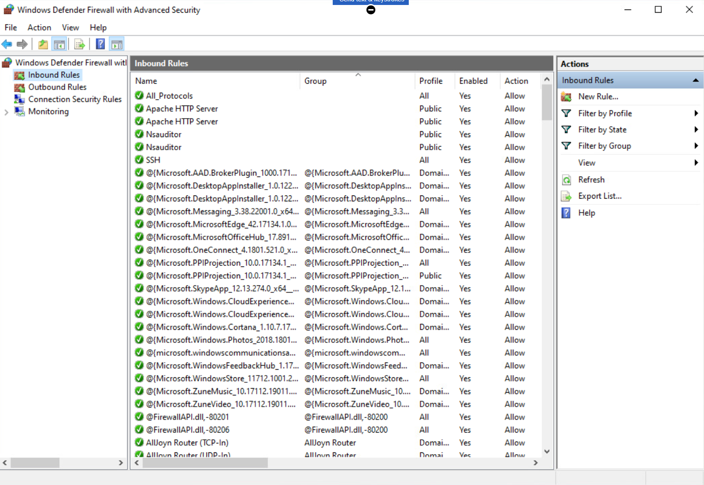
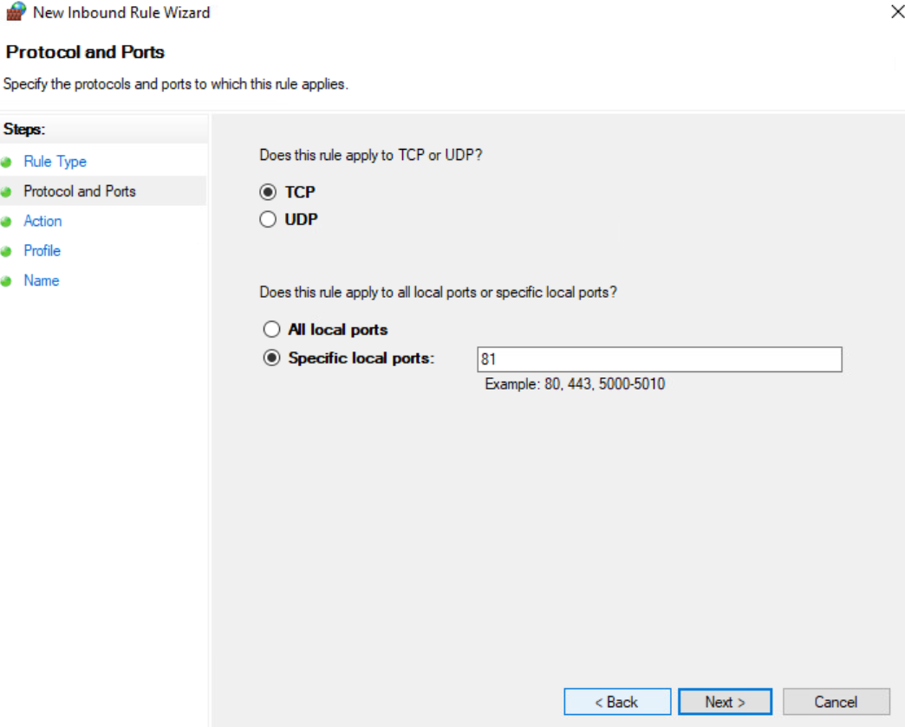
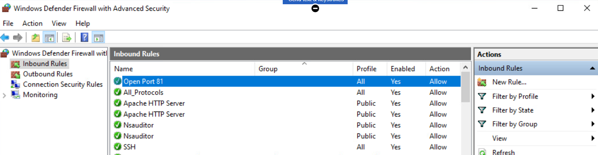

# Configuring Inbound Rules for a Firewall

## Overview

The completed **Open Port 81** rule was configured to allow incoming TCP traffic to a single local port across all network profiles. That scope made profile selection as important to review as the port itself.

This guided Windows lab used Windows Defender Firewall with Advanced Security to create and verify an inbound allow rule for TCP port 81. The retained screenshots show the existing rules, the protocol and port selection, and the completed rule's enabled state, action, and profile coverage.

The verified outcome was a configuration change. No listening service or remote connection test was documented, so the analysis focuses on what the rule permits in policy and what further evidence would establish its effect on traffic.

## Lab Environment and Rule Settings

* **Environment:** Windows training system
* **Tool:** Windows Defender Firewall with Advanced Security
* **Workflow:** New Inbound Rule Wizard
* **Evidence:** Three configuration screenshots

| Setting | Documented value |
| --- | --- |
| Rule name | Open Port 81 |
| Direction | Inbound |
| Protocol | TCP |
| Specific local port | 81 |
| Action | Allow |
| Enabled | Yes |
| Profile | All |

The exercise documents the supplied port setting. No specific application requiring port 81 was identified in the notes.

## Configuration Review

### 1. Open the inbound rule list

The firewall console was opened to **Inbound Rules**, where the existing entries and the **New Rule** action were visible. This established the location for adding an exception for traffic arriving at the Windows host.

An existing entry named **All_Protocols** was already enabled, with **Profile: All** and **Action: Allow**. Its detailed conditions were not shown. The name alone does not prove which protocols or ports it permits, but the entry identifies a useful follow up: inspect existing rules for overlap before attributing a traffic change to the new rule.

**Figure 1. Windows Defender Firewall Inbound Rules**

### 2. Specify TCP and local port 81

The wizard selected **TCP** and **Specific local ports**, with **81** entered as the port value. This limited the new rule's port condition to TCP traffic addressed to local port 81.

The protocol selection matters because TCP and UDP are separate traffic types. The local port identifies the destination on this Windows host, rather than the connecting client's source port.

Creating a firewall exception does not start an application or make it listen on that port. A service and a separate connection test would be needed to demonstrate usable connectivity.

**Figure 2. Configuring TCP Port 81**

### 3. Verify the completed rule

The final rule list showed **Open Port 81** with **Enabled: Yes**, **Action: Allow**, and **Profile: All**. These fields confirmed that the rule was created and enabled across Domain, Private, and Public profiles.

Profile coverage deserves review alongside the port number. An exception that applies on every profile has a wider configuration scope than one limited to the network context where its service is needed. The screenshots record the lab setting; a narrower profile requirement was not implemented.

**Figure 3. Completed Inbound Firewall Rule for Port 81**

## Results and Lessons Learned

The lab produced **one enabled inbound allow rule** for **TCP local port 81**, with **all profiles** selected. The screenshots support rule creation and configuration, rather than a measured change in network reachability.

The main lesson was that a rule's presence is only part of validating a firewall change. Effective behavior also depends on the active profile, the applicable policy, other matching rules, and whether an application is listening. In particular, an explicit block rule can override a conflicting allow rule.

The existing **All_Protocols** entry made policy review especially relevant. A useful validation would establish whether traffic was already permitted, then compare results under controlled conditions. That would distinguish the effect of the new rule from permissions supplied elsewhere in the policy.

## Proposed Follow Up

* **Identify the service requirement:** Document which application needs TCP port 81 and confirm that it is listening before testing access.
* **Review effective policy:** Inspect the new rule's properties, the active profile, and potentially overlapping rules, including All_Protocols.
* **Test connectivity:** From another authorized lab host, use a TCP connection test and compare results with the rule enabled and disabled while controlling other applicable rules.
* **Narrow the exception:** Evaluate the required profiles, permitted source addresses, and application or service scope against the actual access requirement.
* **Document the rule's lifecycle:** Record its purpose and review date, then disable or remove the exception when it is no longer needed.

These are proposed extensions. The documented exercise ended with the completed rule visible in the inbound rule list.