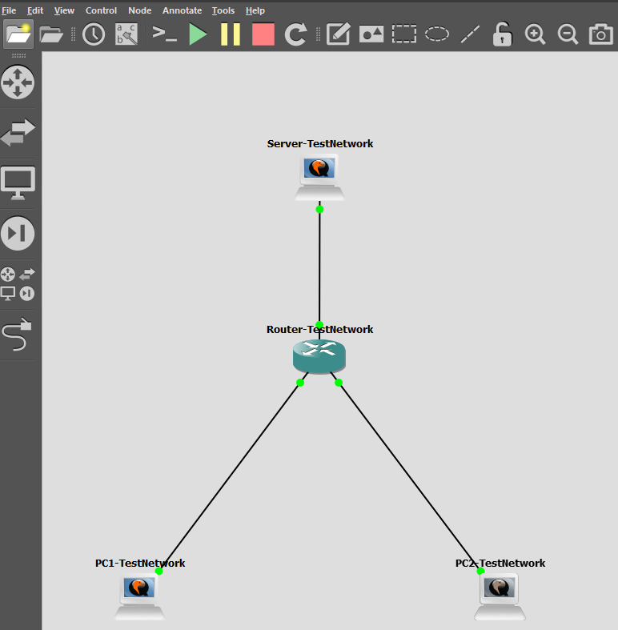
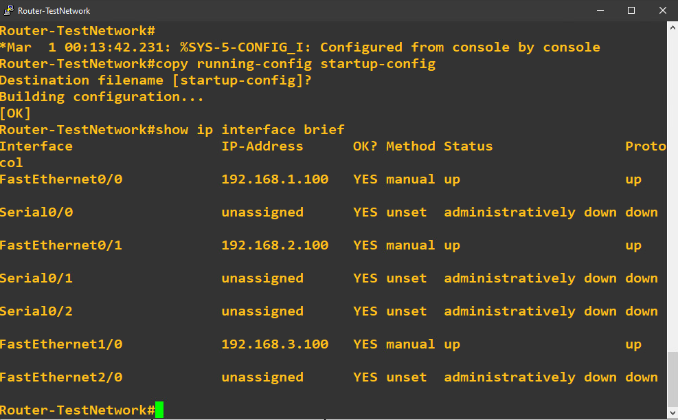
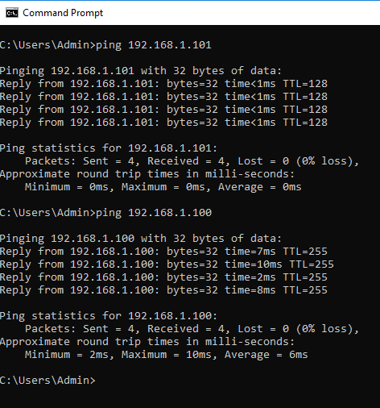
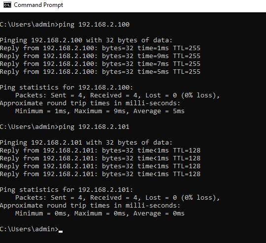
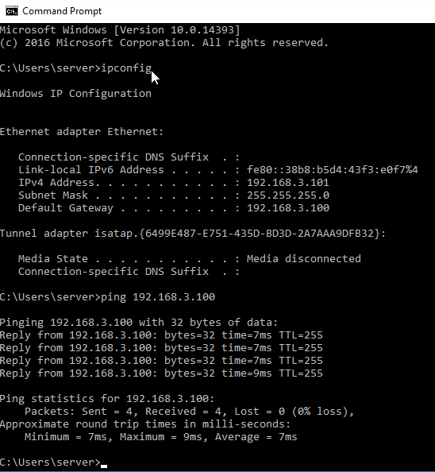
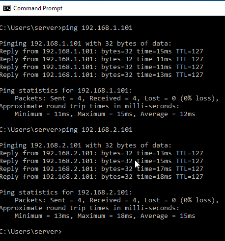
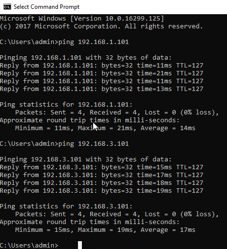
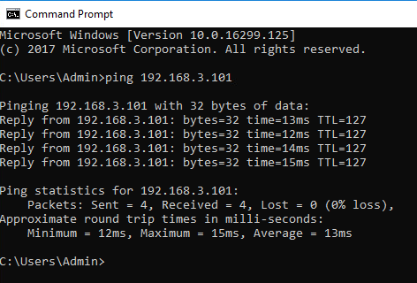

# GNS3 Multi Network Configuration and Connectivity Testing

## Overview

PC1, PC2, and the Windows server each occupied a different subnet. By the end of this lab, every endpoint could reach the other two, with successful ping tests in all six directions. That result established more than active links in GNS3: the endpoint addressing and Cisco router configuration supported communication across three separate networks.

The exercise used a Cisco 3745 router, two Windows computers, and a Windows server. Static addresses and subnet specific gateways were configured, the router settings were saved, and connectivity was checked at several levels, from PC1's own address to remote endpoints.

A useful troubleshooting decision came during PC1 configuration, when the automatic DNS option was greyed out. Because the required tests used numeric IP addresses, DNS was left unchanged and testing continued. The successful results verified IP connectivity without claiming that name resolution had been configured or tested.

## Lab Environment and Addressing

* **Platform:** GNS3
* **Router:** Cisco 3745
* **Endpoints:** Two Windows computers and one Windows server
* **Tools:** Cisco IOS console, Windows Command Prompt, `ipconfig`, and `ping`
* **Scope:** Three directly connected IPv4 subnets within a virtual training network

| Endpoint | Subnet | Static IPv4 address | Default gateway | Router interface |
| --- | --- | --- | --- | --- |
| PC1 | 192.168.1.0/24 | 192.168.1.101 | 192.168.1.100 | FastEthernet0/0 |
| PC2 | 192.168.2.0/24 | 192.168.2.101 | 192.168.2.100 | FastEthernet0/1 |
| Windows server | 192.168.3.0/24 | 192.168.3.101 | 192.168.3.100 | FastEthernet1/0 |

Each subnet used a mask of **255.255.255.0**. Each endpoint's gateway was the router address on its own subnet. These addresses belong to the virtual lab and do not identify a personal network.

## Configuration and Validation

### 1. Confirm the topology is running

The topology connected each endpoint to a separate router interface. Green connection indicators showed that the virtual links were active, providing the starting point for addressing and connectivity checks.

Link indicators alone could not confirm that the endpoints had the correct addresses or could communicate across subnets. Those questions required the console checks and ping results that followed.

**Figure 1. Completed GNS3 Network Topology**



### 2. Verify and save the router configuration

The router console showed three addressed interfaces with both **Status** and **Protocol** reported as **up**. Each interface corresponded to one endpoint subnet.

The documented verification command was:

```text
show ip interface brief
```

Unused interfaces appeared as unassigned and administratively down. They were outside the required topology, so their status did not indicate a failure on the three active connections.

The running configuration was also copied to the startup configuration:

```text
copy running-config startup-config
```

The console returned **[OK]**, confirming the save operation. This documented configuration retention; a router restart test was not captured.

**Figure 2. Cisco Router Interface Configuration**



### 3. Check PC1 locally before testing remote endpoints

PC1 successfully pinged its own address, **192.168.1.101**, and its local gateway, **192.168.1.100**. Each command returned four replies with zero packet loss.

These checks served different purposes. The self ping checked response through the local IP stack, while the gateway ping verified communication with the router on PC1's subnet. A self ping alone would not establish that the external link was working.

**Figure 3. PC1 Local and Gateway Connectivity Tests**



### 4. Extend PC1 testing to the PC2 network

PC1 then successfully pinged the router's PC2 facing address, **192.168.2.100**, and PC2 itself, **192.168.2.101**. Both tests returned four replies with zero packet loss.

The remote router interface test checked another address on the router. Reaching PC2 provided stronger evidence because the traffic also had to reach a separate endpoint and receive a reply across the subnet boundary.

**Figure 4. PC1 to PC2 Gateway and Device Connectivity Tests**



### 5. Verify the server's addressing and local gateway

The server's `ipconfig` output confirmed its address, subnet mask, and default gateway against the lab addressing plan. Its gateway ping returned four replies with zero packet loss.

This combined configuration evidence with a communication test. An address displayed by `ipconfig` showed what was configured; the replies showed that the server could reach the router interface on its own subnet.

**Figure 5. Windows Server Network Configuration and Gateway Connectivity**



### 6. Test communication from the server to both clients

The server successfully pinged PC1 and PC2. Each destination returned four replies with zero packet loss, verifying communication initiated from the server subnet toward both client subnets.

**Figure 6. Server to Client Connectivity Tests**



### 7. Test communication initiated from PC2

PC2 successfully pinged PC1 and the server. These tests added evidence from a second source endpoint rather than relying entirely on commands run from PC1. Both returned four replies with zero packet loss.

**Figure 7. PC2 to PC1 and Server Connectivity Tests**



### 8. Complete PC1's endpoint coverage

PC1 successfully pinged the server, returning four replies with zero packet loss. Together with the earlier tests, this completed all six directed endpoint combinations: each of the three endpoints had successfully initiated a test to the other two.

**Figure 8. PC1 to Server Connectivity Test**



## Troubleshooting Decision

During PC1 setup, the option to obtain a DNS server address automatically was greyed out. The required checks used IP addresses directly, so name resolution was not needed for those commands. DNS settings were left unchanged while the addressing, gateway, and connectivity checks continued.

This was a decision to keep the investigation focused on the requirement. The successful pings showed that the unavailable DNS option did not prevent the documented IP tests from succeeding. They did not verify hostname resolution.

## Results and Lessons Learned

* **Three router interfaces** were addressed and reported as up/up.
* **10 documented ping commands** sent 40 requests and received 40 replies, with zero packet loss during those tests.
* **All six directed endpoint combinations** succeeded across the three subnets.
* **The router configuration was saved**, with confirmation visible in the console.

The main lesson was to verify connectivity in stages. Active virtual links, an addressed router interface, a reachable gateway, and a reachable remote endpoint each answer a different question. Combining those checks gives a clearer basis for locating a problem than treating a green topology indicator as proof that the network works.

The lab also clarified the difference between separating address spaces and enforcing access restrictions. The endpoints occupied different subnets, but the tested ICMP traffic could pass between them. A security policy would require additional controls and tests to establish which communication should be allowed or blocked.

These results establish IP reachability at the time of testing. They do not establish application availability, DNS functionality, or sustained performance under load.

## Proposed Follow Up

* Capture the router's routing table to document the connected networks alongside interface status.
* Add hostname based tests after configuring and verifying DNS.
* Test a selected server application separately from ICMP reachability.
* Introduce a controlled addressing or gateway error in a lab copy, then record the failed test, diagnosis, correction, and successful retest.
* Add an access policy with explicit allowed and blocked traffic tests to extend the exercise from connectivity validation to security control validation.

These are proposed extensions and were not completed in the documented lab.