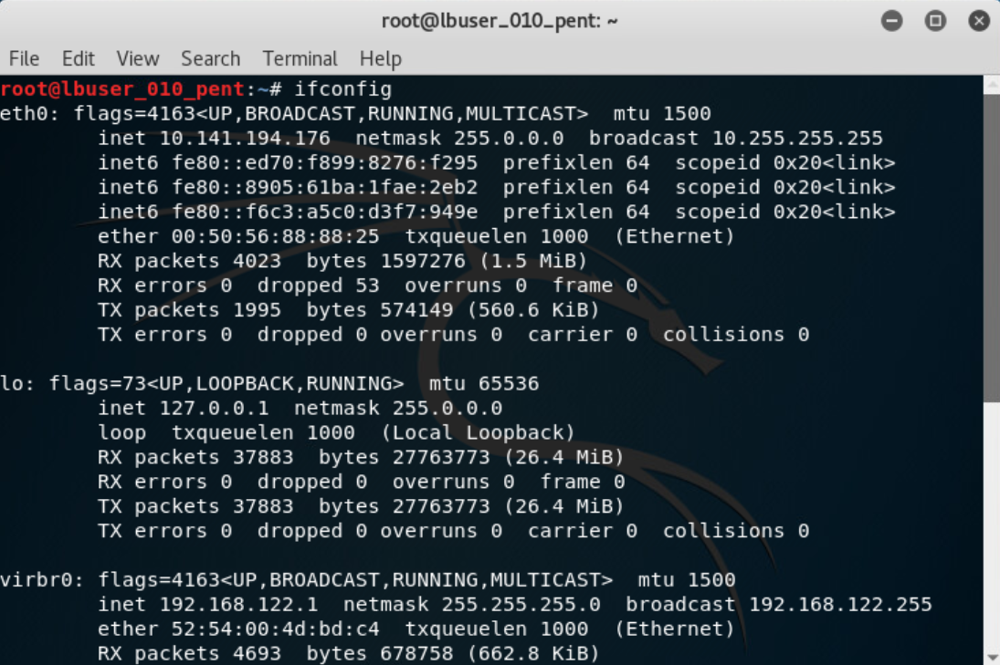
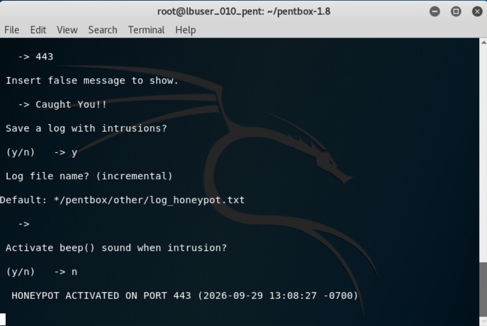
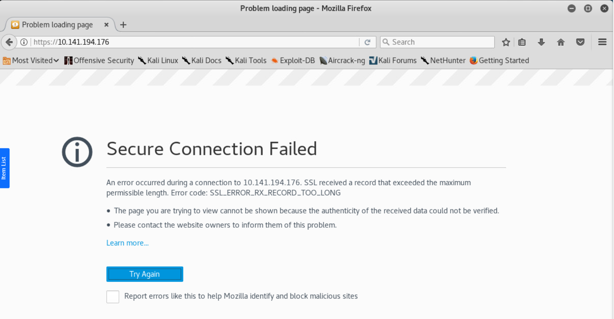
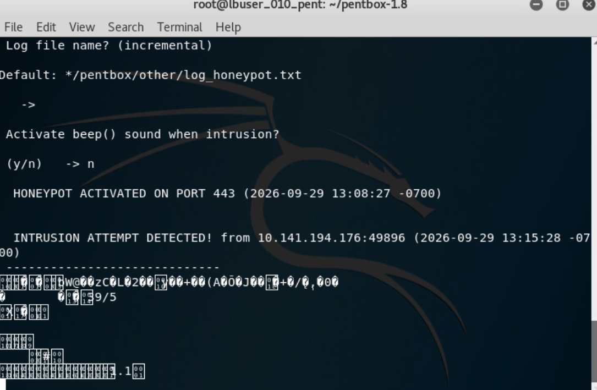

# Honeypot Setup and Intrusion Detection Lab

## Overview

Firefox displayed **Secure Connection Failed**, while the PentBox terminal displayed **INTRUSION ATTEMPT DETECTED!**. Those two results answered different questions: the browser could not establish a usable HTTPS session, but the honeypot received and reported the connection attempt.

This guided lab configured a PentBox honeypot on a Kali Linux virtual machine to listen on TCP port 443, use a custom response message, and save detected activity. A controlled browser test then provided evidence that the listener was responding to incoming connections.

The reported source address matched the Kali VM's own test address. The result therefore supports detection of the controlled lab connection rather than discovery of an outside attacker. Comparing the setup, browser response, and terminal output made the outcome clearer than judging success from the browser page alone.

## Lab Environment and Configuration

* **System:** Kali Linux virtual machine
* **Tool:** PentBox honeypot, using the lab's `pentbox-1.8` directory
* **Test client:** Mozilla Firefox
* **Interface reviewed:** eth0
* **Scope:** Controlled connection test within the training environment

| Setting | Documented value |
| --- | --- |
| Listening port | TCP 443 |
| Custom response message | Caught You!! |
| Save intrusion log | Yes |
| Log filename | Default log_honeypot.txt |
| Audible alert | No |

The network identifiers visible in the screenshots belong to the virtual training environment. No personal network details are repeated in the written analysis.

## Setup and Validation

### 1. Identify the test address

The `ifconfig` output showed multiple interfaces, including eth0, loopback, and a virtual bridge. The lab used the IPv4 address assigned to **eth0** for the browser connection test.

Identifying the interface was important because the different addresses served different purposes. The eth0 address also provided a reference for comparing the destination in Firefox with the source reported by the honeypot.

**Figure 1. Identifying the Kali Linux IP Address**



### 2. Activate the listener

The configuration selected port **443**, entered **Caught You!!** as the custom message, enabled log saving, accepted the default log filename, and disabled the audible alert.

The terminal then displayed **HONEYPOT ACTIVATED ON PORT 443**, establishing that the tool reported successful listener activation. The later connection alert added evidence that the listener was receiving traffic.

The response message was configured, but the browser screenshot did not show it being rendered. Likewise, selecting log saving documents the requested behavior; the saved file's contents were not independently inspected in the retained evidence.

**Figure 2. Honeypot Activated on Port 443**



### 3. Test the connection and review the browser error

Firefox attempted an HTTPS connection to the VM's eth0 address. It displayed **Secure Connection Failed** with this error code:

```text
SSL_ERROR_RX_RECORD_TOO_LONG
```

Port 443 is commonly used for HTTPS, but choosing that port does not by itself provide TLS support. In this lab, the error was consistent with a mismatch between the browser's HTTPS request and the simple listener's configured response. That is an interpretation of the available evidence, not a confirmed diagnosis from a packet capture.

The useful distinction was between receiving a connection and completing an HTTPS session. The browser error did not establish that the honeypot was unreachable, especially when the terminal subsequently showed the detected attempt.

**Figure 3. Testing the Honeypot Connection**



### 4. Inspect the detection output

The terminal displayed **INTRUSION ATTEMPT DETECTED!**, followed by a source address, source port, timestamp, and received data. The source address matched the VM address identified earlier, and the reported source port was **49896**.

That source port belonged to the connecting side. It was separate from the honeypot's listening port, 443. Reading the two correctly helps avoid confusing the client connection with the monitored service.

The received data contained unreadable characters. The screenshot establishes that data was received, but it does not provide a decoded protocol exchange or evidence of a malicious payload. The known browser test also supplied the context needed to interpret the tool's intrusion label.

**Figure 4. Honeypot Detecting an Intrusion Attempt**



## Troubleshooting

An early browser test used `htttps` instead of `https`, so it did not produce the expected test result. The scheme was corrected, and the final screenshot captured the HTTPS connection error. Checking the typed address kept the troubleshooting focused on the test input before interpreting the listener's behavior.

## Results and Lessons Learned

* **One TCP listener** was reported active on port 443.
* **One visible detection alert** documented the controlled test connection and its source details.
* **Log saving was selected**, while persistent log contents remained unverified.
* **The HTTPS session failed**, but the terminal evidence confirmed receipt of the connection attempt.

The main lesson was to evaluate each result against the purpose of the test. Browser behavior, listener activation, console detection, and persistent logging are separate pieces of evidence. Combining them gives a clearer account of what worked and what still needs validation.

The exercise also reinforced the need to interpret an alert in context. The same event label can describe a deliberate test, an unexpected connection, or activity requiring further investigation. Source identity and the known test conditions mattered more than the word intrusion alone.

## Proposed Follow Up

* **Verify the saved log:** Locate the actual log file and compare its recorded event with the console's source details and timestamp.
* **Test from another lab VM:** Confirm detection of a connection from a distinct authorized client address rather than relying only on the current test source.
* **Inspect the protocol exchange:** Capture and decode a controlled connection to assess the HTTPS mismatch and identify the received data.
* **Document test context:** Record the client, test time, expected result, and observed alert so validation traffic can be distinguished from unexpected activity.
* **Preserve the evidence:** Export relevant logs with their timestamps and keep the honeypot within the intended isolated lab scope.

These are proposed extensions. The documented result was listener activation and a console alert during the controlled browser test.