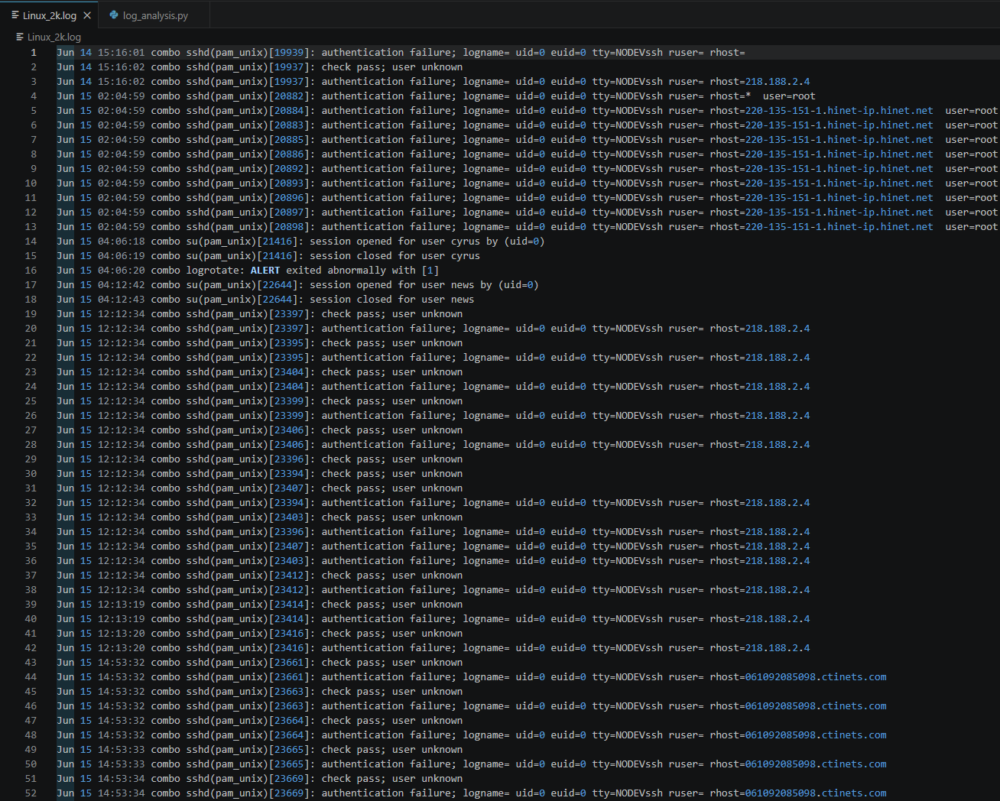
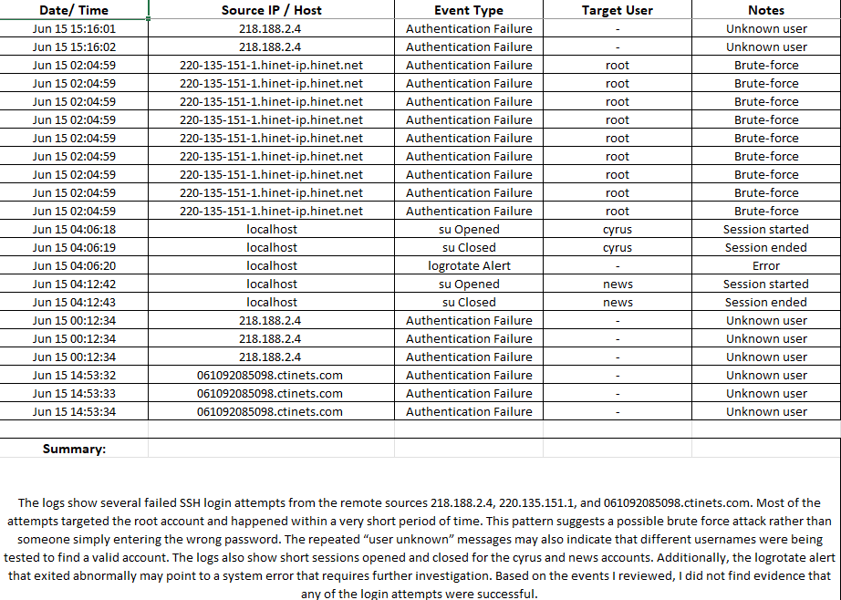
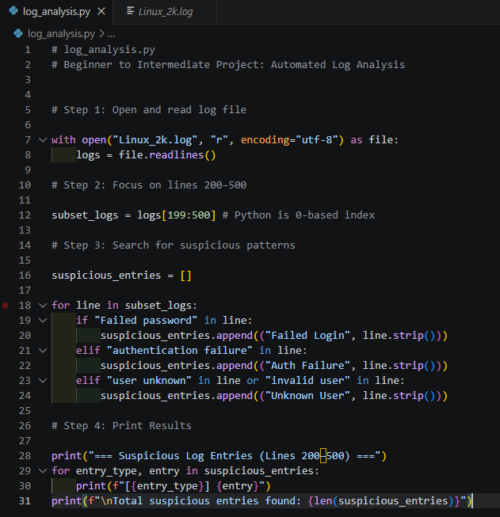
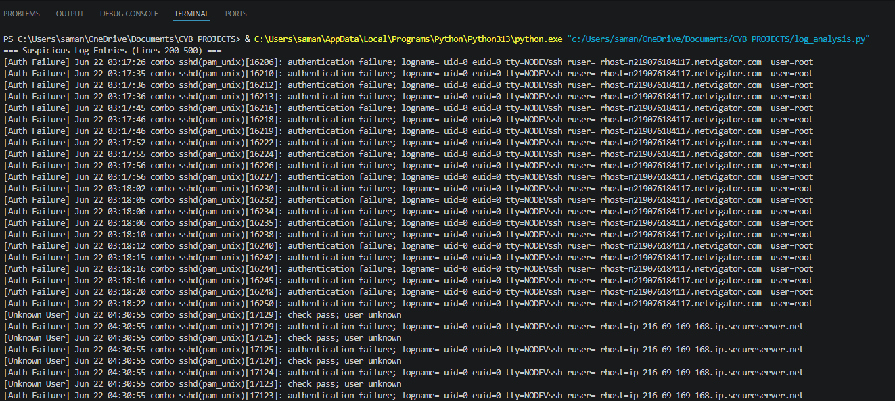
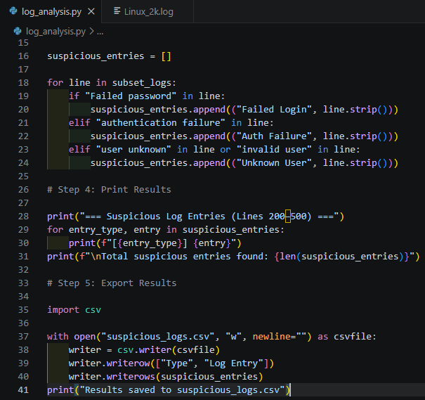
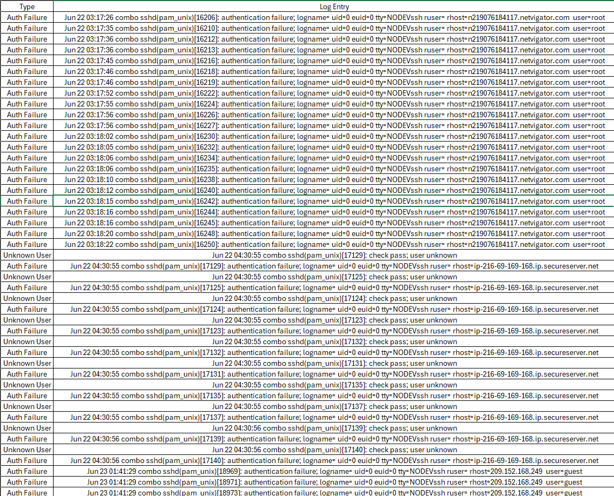
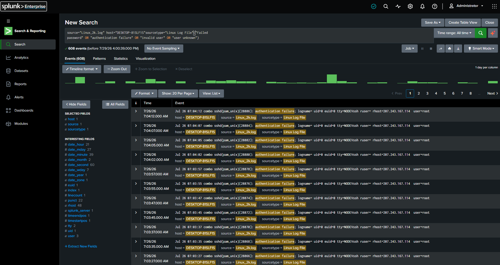
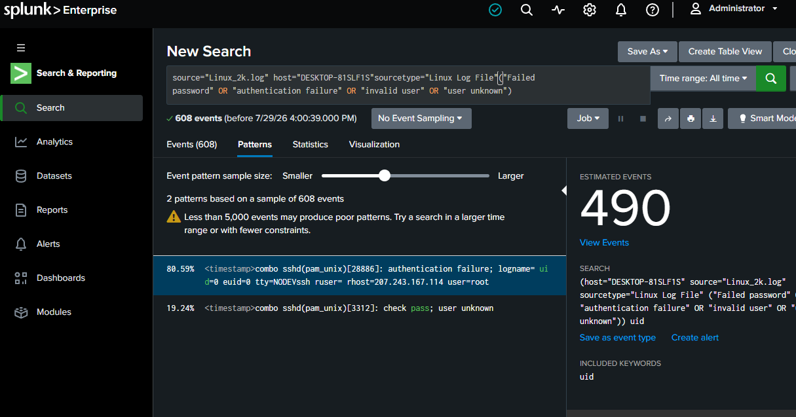
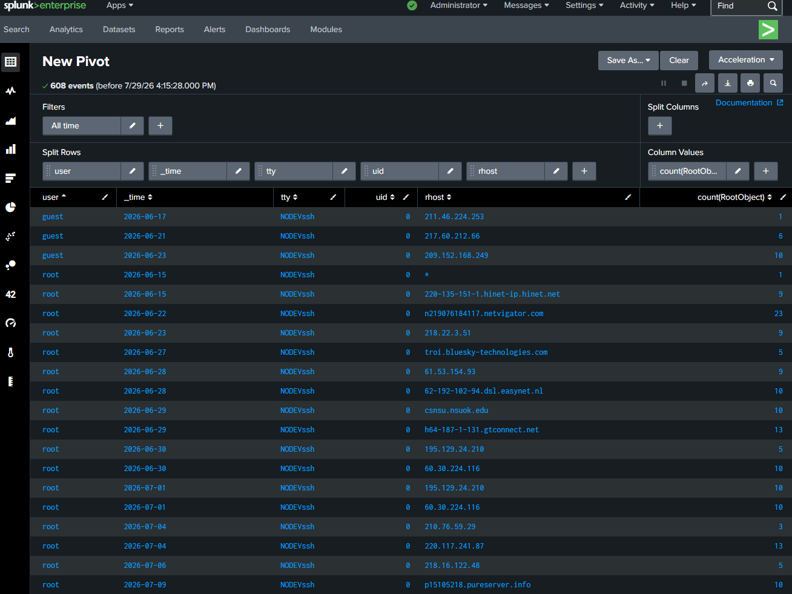
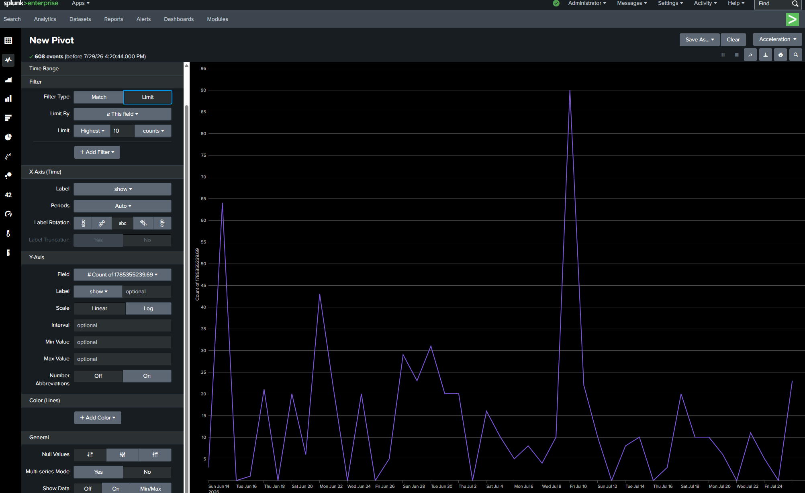

# Linux Log File Analysis, Automation, and SIEM Visualization

## Overview

Repeated SSH authentication failures targeting `root` drove this investigation of `Linux_2k.log`. The question was whether the records showed isolated login mistakes or a pattern of repeated access attempts. Answering it required looking at the source, account, and timing together rather than treating every failed login as an attack.

The work began with manual review in Excel, followed by a Python filter and CSV export, then a broader search in Splunk. Each stage served a different purpose: manual review established context, Python made a defined portion of the review repeatable, and Splunk exposed recurring messages and grouped activity across the uploaded file. Incorrect indentation, an extra quotation mark, and an unsuccessful upload also required troubleshooting before the results could be reviewed.

The strongest evidence was a sequence of 12 visible authentication failure events targeting `root` from `207.243.167.114` within 45 seconds. That pattern supported a suspected automated brute force attempt. The reviewed evidence did not establish a successful login or compromise.

## Tools and Review Scope

| Tool | Role in the project |
| --- | --- |
| VS Code | Inspect the raw log and develop the Python script |
| Excel | Record manual observations and review the exported CSV |
| Python and the `csv` module | Classify matching lines and export the results |
| Splunk Enterprise | Search the uploaded log, inspect patterns, and build Pivot views |

This project analyzed an existing Linux log file. The documented workflow covers file analysis, scripting, and SIEM investigation.

| Review | Scope |
| --- | --- |
| Manual analysis | Selected records, including authentication failures, local sessions, and a logrotate error |
| Python analysis | Lines 200 through 500, a 301-line subset |
| Splunk analysis | A search across the uploaded log that returned 608 matching events |

## Investigation and Evidence

### 1. Establish context from the original records

The raw log contained SSH authentication failures, unknown user messages, local `su` sessions, and a logrotate alert. Reviewing these records together helped distinguish remote authentication activity from other system events before choosing the filter criteria.

Several records targeted `root`, while others reported `user unknown`. A failure alone was insufficient to explain intent. Repetition, closely spaced timestamps, and recurring remote sources were the details that made particular sequences worth investigating.

**Screenshot 01: Source log review**



### 2. Document the manual findings

An Excel worksheet organized observations by date and time, source IP or hostname, event type, target user, and notes. It captured repeated failures associated with sources such as `218.188.2.4` and `220-135-151-1.hinet-ip.hinet.net`, alongside local sessions for `cyrus` and `news`.

The worksheet used the label “Brute-force” for a repeated sequence. The final assessment treats that label as a hypothesis supported by the pattern. Local session openings and the logrotate error were recorded separately; their presence did not connect them to the remote failures.

**Screenshot 02: Manual analysis worksheet**



### 3. Turn the review criteria into a Python filter

The script read `Linux_2k.log` and selected the review range with:

```python
subset_logs = logs[199:500]
```

Python's zero-based indexing makes this slice correspond to lines 200 through 500. Within that subset, literal text checks assigned matching records to three categories:

| Text matched | Output category |
| --- | --- |
| `Failed password` | Failed Login |
| `authentication failure` | Auth Failure |
| `user unknown` or `invalid user` | Unknown User |

The `if` and `elif` structure assigned each matching line to the first applicable category. Keeping the full log entry beside its category preserved the timestamp, process details, remote source, and account for review.

**Screenshot 03: Python filter**



### 4. Correct execution errors and inspect the output

Incorrect indentation and an extra quotation mark initially prevented the script from running. After locating and correcting both errors, the script executed successfully and printed categorized records in the terminal.

The visible output included repeated authentication failures targeting `root`, followed by unknown user records and additional failures. The categorized entries retained the timestamps, remote sources, and account details needed for investigation.

**Screenshot 04: Python results**



### 5. Export the matches for review

The script was extended to write `suspicious_logs.csv` with two columns: `Type` and `Log Entry`. This made the categorized results available in a spreadsheet while preserving the original message text.

```python
import csv

with open("suspicious_logs.csv", "w", newline="") as csvfile:
    writer = csv.writer(csvfile)
    writer.writerow(["Type", "Log Entry"])
    writer.writerows(suspicious_entries)
```

**Screenshot 05: CSV export code**



Rerunning the script generated the CSV. The Excel view showed both headers, the assigned categories, and the complete log entries.

**Screenshot 06: Exported results**



### 6. Search the uploaded log in Splunk

The initial file upload did not complete correctly. A fresh copy of `Linux_2k.log` was downloaded and uploaded successfully, allowing the investigation to continue against the raw log.

The search filtered the uploaded source for failed passwords, authentication failures, and invalid or unknown users:

```spl
source="Linux_2k.log" sourcetype="Linux Log File"
("Failed password" OR "authentication failure" OR "invalid user" OR "user unknown")
```

The documented search returned **608 matching events**. This result covered a broader scope than the Python subset. It is an event count, not a count of unique login attempts, because related messages can describe the same authentication sequence.

The visible July 26 records contained 12 authentication failure events from `207.243.167.114`, targeting `root` between **07:03:27 and 07:04:12**. The recurring source, privileged account, and short interval gave a concrete basis for the suspected brute force finding.

**Screenshot 07: Splunk event search**



### 7. Compare recurring message patterns

The Patterns tab identified two message patterns from a sample of 608 events. The selected authentication failure pattern displayed **490 estimated events**.

That estimate described a message pattern; it did not establish that all 490 events came from the IP shown in the representative record. The interface also flagged the small sample size. Pattern grouping helped organize the review, while the individual records supplied the evidence for the specific source and account finding.

**Screenshot 08: Splunk patterns**



### 8. Group events and visualize activity

A Pivot table grouped results by `user`, `_time`, `tty`, `uid`, and `rhost`. This exposed activity involving both `root` and `guest` across different remote sources. For example, the displayed June 22 group contained 23 events targeting `root` from `n219076184117.netvigator.com`.

**Screenshot 09: Splunk statistics**



A Pivot line chart showed variation in matching event volume over time and highlighted periods for closer review. The chart provided an overview; attributing a peak to one source or account required returning to the grouped results and raw events.

**Screenshot 10: Splunk timeline**



## Results and Lessons Learned

The completed workflow produced a manual analysis worksheet, a working Python filter, a verified CSV export, and Splunk search, pattern, statistics, and visualization views. The investigation connected a suspected brute force finding to a specific account, remote source, and visible time interval.

The most useful change in approach was moving from “failed login means attack” to evaluating the surrounding sequence. Repeated failures against `root` within seconds warranted attention, while unrelated local sessions and system errors needed their own context.

Troubleshooting also reinforced that a usable result depends on the full workflow. Correcting the script was followed by checking its output and export. Resolving the upload issue was followed by confirming searchable records in Splunk.

## Possible Improvements

These are extensions to the completed work:

* Make the Python review range configurable and account for capitalization differences. The current literal checks cover a fixed subset and specific message spellings.
* Extract timestamps, accounts, remote sources, and process IDs into separate CSV fields so related messages can be compared without counting every line as a distinct attempt.
* Validate timestamp interpretation before building alert thresholds. The raw messages omit a year, while Splunk displays 2026; the inferred year and timezone should be confirmed before relying on absolute dates.