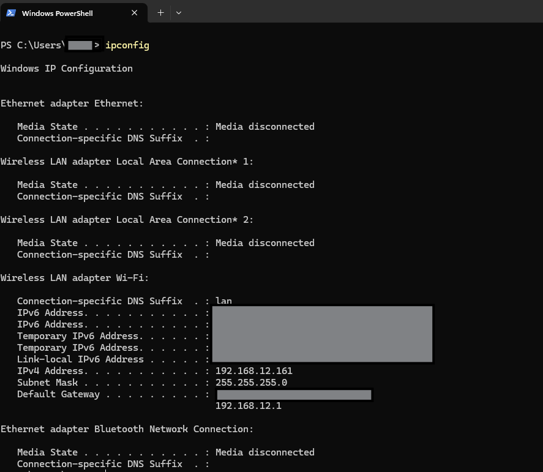
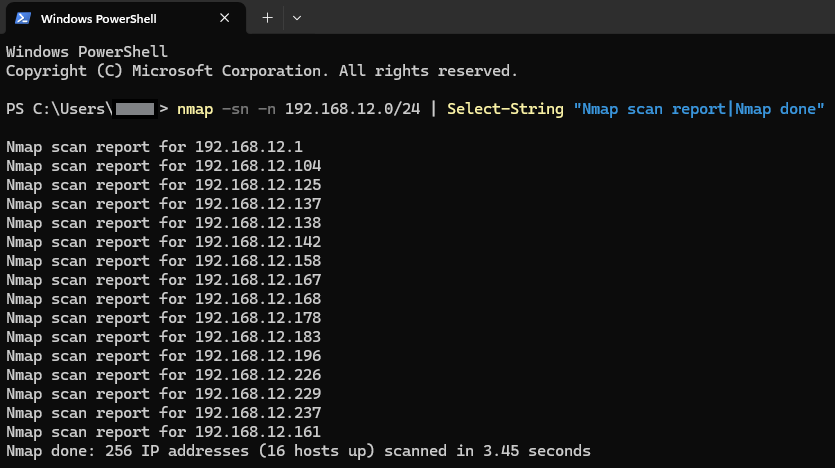
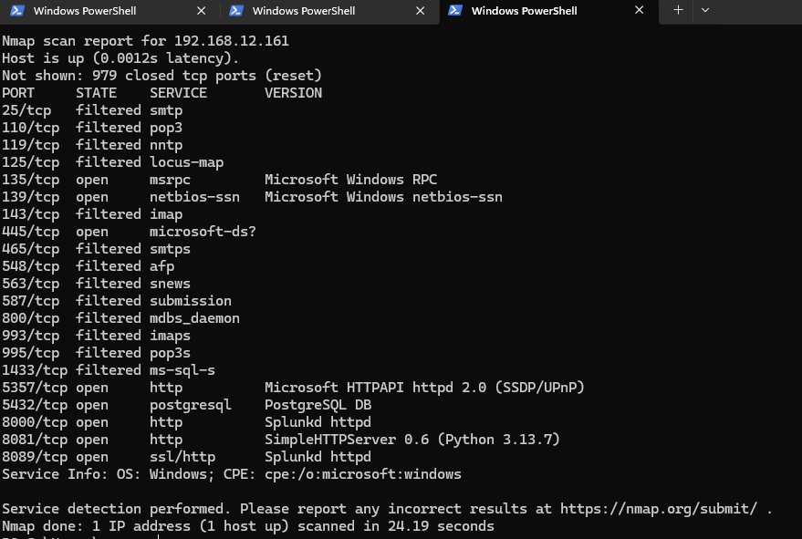
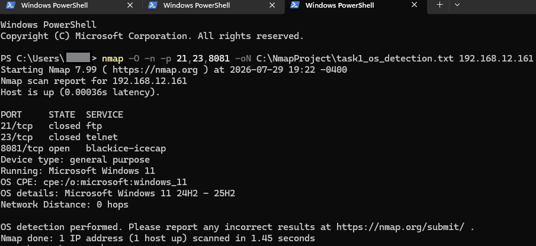
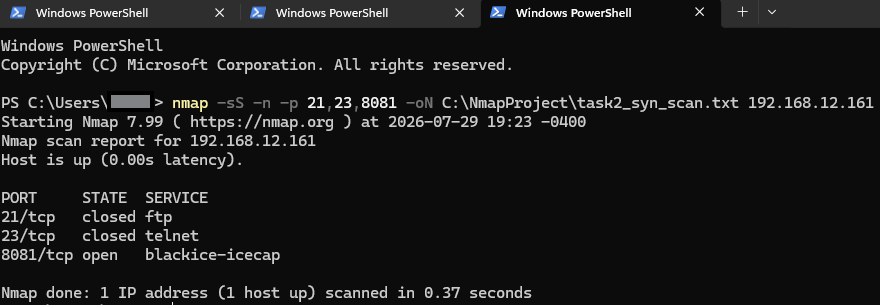
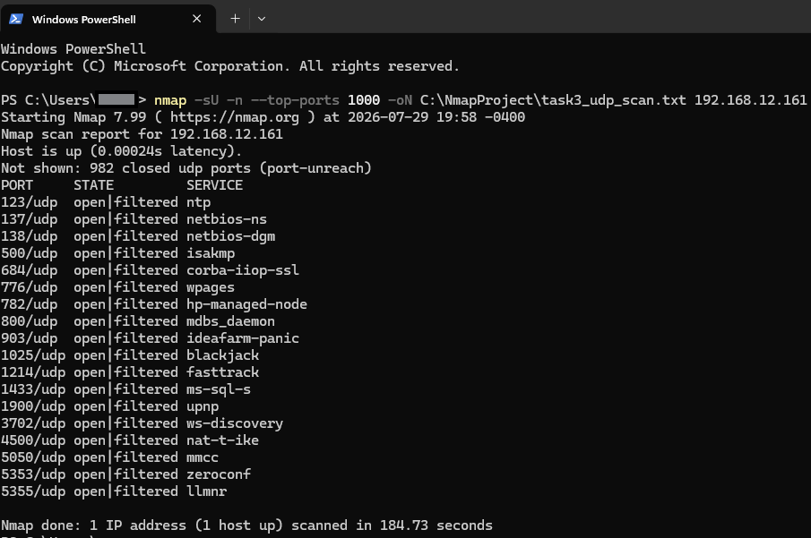
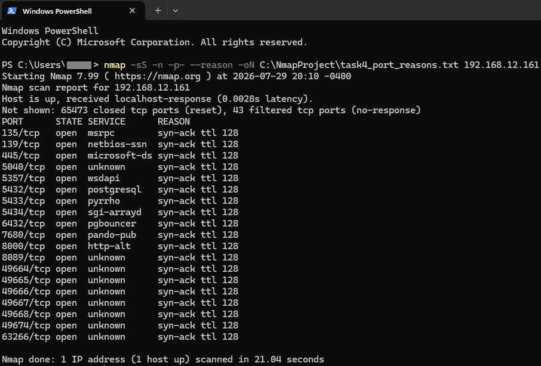
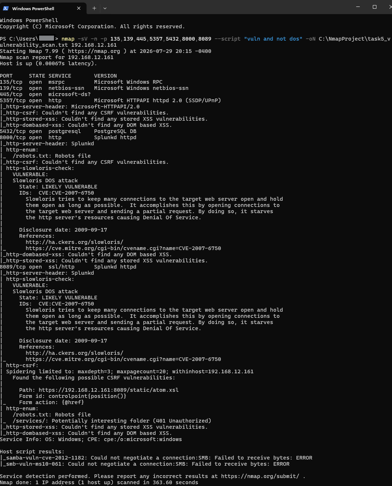
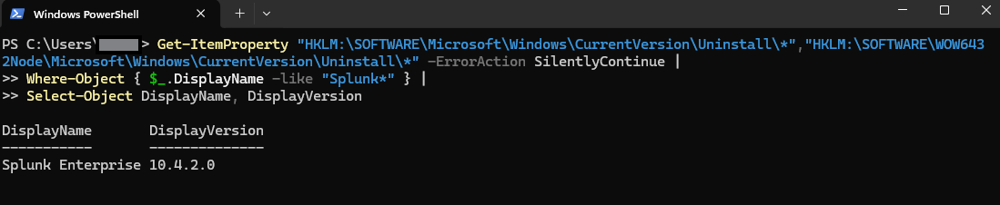
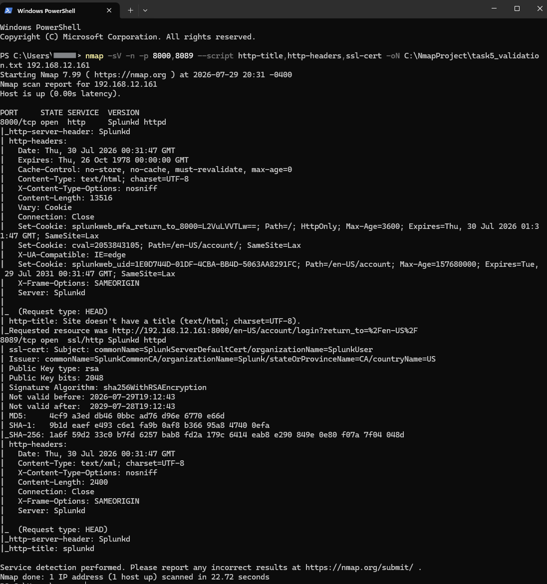

# Network Scanning and Host Enumeration with Nmap

## Overview

A temporary Python web server on port `8081` gave this project a known service to compare against Nmap's results. Service detection identified Python, while scans without version detection labeled the same port `blackice-icecap`. That mismatch showed why identifying an application requires more than reading a port label.

Host discovery established the network context before deeper scans focused on the personal Windows computer used for this lab. TCP, UDP, and operating system checks built a service inventory. Vulnerability scripts then flagged possible Slowloris behavior on Splunk services. Follow-up product, HTTP, and TLS checks confirmed service details, while exploitability remained unconfirmed.

## Environment and Scope

* **Tools:** Nmap 7.99, Windows PowerShell, and a temporary Python HTTP server.
* **Discovery range:** An authorized private network with a `/24` subnet.
* **Target for deeper scans:** The personal Windows computer used for this lab.
* **Installed services:** Windows networking, PostgreSQL, and Splunk Enterprise.

Nmap ran on the target itself. These local results do not establish access from the internet or another device. Commands use `$labSubnet` as a placeholder for the private network range; personal network addresses are omitted from this write up.

## Investigation and Evidence

### 1. Establish the target and network range

The active network configuration was reviewed with `ipconfig`. The assigned IPv4 address identified the lab target, and the subnet mask established a `/24` discovery range.

The subnet defined the discovery range; deeper testing remained limited to the owned computer.

**Screenshot 01: Network configuration**



### 2. Discover active addresses

Host discovery used `-sn` to check for responding hosts without scanning ports. The `-n` option disabled name resolution, and PowerShell filtering kept the displayed results focused on addresses and the scan summary.

```powershell
nmap -sn -n $labSubnet | Select-String "Nmap scan report|Nmap done"
```

The scan checked **256 addresses** and reported **16 hosts up in 3.45 seconds**. An unfamiliar address alone did not justify classifying a device as malicious.

**Screenshot 02: Host discovery**



### 3. Identify services and compare them with the system

A temporary Python HTTP server was started on port `8081` as a controlled example with a known application and purpose.

The scan used `-sV` for service detection and saved a normal text report with `-oN`. Across the 1,000 common TCP ports, it reported **8 open, 13 filtered, and 979 closed**.

| TCP port | Reported service or evidence | Interpretation |
| --- | --- | --- |
| 135 | Microsoft Windows RPC | Windows RPC service |
| 139 | Microsoft Windows NetBIOS-SSN | Windows networking service |
| 445 | `microsoft-ds?` | Consistent with Windows SMB; the label was tentative |
| 5357 | Microsoft HTTPAPI httpd 2.0 | Windows HTTP service associated with device discovery |
| 5432 | PostgreSQL DB | Database service requiring comparison with installed applications |
| 8000 | Splunkd httpd | Splunk web service |
| 8081 | SimpleHTTPServer 0.6, Python 3.13.7 | Temporary web server created for the project |
| 8089 | Splunkd httpd over SSL/HTTP | Splunk management service |

Windows services matched the expected operating system, Splunk was recognized from the earlier log analysis project, and Python matched the controlled setup. PostgreSQL needed comparison with installed applications.

**Screenshot 03: TCP service detection**



### 4. Compare operating system detection with the known target

An `-O` scan against ports `21`, `23`, and `8081` identified Microsoft Windows 11, with details listed as 24H2 through 25H2. This matched the known computer; no accuracy percentage was displayed. The zero-hop distance reflected the local scan, and closed ports `21` and `23` showed no FTP or Telnet listeners in this check.

**Screenshot 04: Operating system detection**



### 5. Inspect TCP SYN results and service labels

A targeted `-sS` scan again reported ports `21` and `23` as closed and port `8081` as open. It completed in **0.37 seconds**.

This scan and OS detection labeled `8081` as `blackice-icecap`; neither used `-sV`. The service scan identified the known Python server, demonstrating the difference between a port-based name and evidence from the application.

**Screenshot 05: TCP SYN scan**



### 6. Interpret the UDP results

The UDP scan used `-sU --top-ports 1000` against the same computer. It completed in **184.73 seconds** and reported:

* **982 closed ports**, with `port-unreach` responses.
* **18 ports marked `open|filtered`**.
* **No confirmed open UDP ports**.

Names such as NTP and NetBIOS reflected common port assignments without confirming services. An `open|filtered` result left two possibilities unresolved: an open service remained silent, or filtering prevented a response.

The longer runtime was recorded alongside scope. A three-port TCP check and a 1,000-port UDP scan do not provide a direct speed comparison.

**Screenshot 06: UDP scan**



### 7. Expand TCP coverage and inspect response reasons

An all-port TCP SYN scan used `-p-` to cover ports 1 through 65,535 and `--reason` to show why Nmap assigned each state. It reported **19 open, 43 filtered, and 65,473 closed ports** in **21.04 seconds**.

| Response shown | What it supported |
| --- | --- |
| `syn-ack` | An open TCP port responded to the SYN probe |
| `reset` | A closed TCP port rejected the probe |
| `no-response` | Nmap received no response and classified the port as filtered |
| `localhost-response` | The host was recognized as the local computer |

Broader coverage exposed additional listeners. Service state also mattered: `8081` appeared earlier but was absent from this later report. Comparisons need both scan coverage and the services running at the time. TTL 128 was consistent with Windows but did not independently identify the operating system.

**Screenshot 07: All TCP ports and response reasons**



### 8. Assess vulnerability script findings

Scripts were run against seven known TCP services using `vuln and not dos`, excluding the denial of service category. The `http-slowloris-check` script still ran because its categories are `safe` and `vuln`. It checks timeout behavior without launching the full denial of service attack.

| Target | Script result | Assessment |
| --- | --- | --- |
| Splunk ports 8000 and 8089 | Slowloris: `LIKELY VULNERABLE`, with CVE-2007-6750 in the output | Potential timeout behavior requiring further validation; service disruption was not demonstrated |
| Port 8089, `/static/atom.xsl` | Possible CSRF, with form values `controlpoint{position()}` and `{@href}` | Low confidence; the reported values resembled XSL expressions and raised a possible parsing issue |
| Port 5357 | No CSRF, stored XSS, or DOM XSS found by the completed scripts | No issue identified within those specific checks |
| Windows SMB checks | Connection negotiation errors | Inconclusive; the checks did not complete successfully |

The CVE identifier did not independently establish that Splunk was affected. The checker indicates timeout extension behavior; denial of service impact depends on server architecture and resource limits.

**Screenshot 08: Vulnerability script results**



### 9. Verify the product and inspect the service responses

PowerShell queries of the installed application records identified **Splunk Enterprise 10.4.2.0**. This provided a product version to use when comparing the findings with vendor security information.

**Screenshot 09: Installed Splunk version**



A focused follow-up scan used `http-title`, `http-headers`, and `ssl-cert` on ports `8000` and `8089`. It confirmed Splunkd responses, a login redirect on the web service, and a Splunk default certificate on the management service. The responses also included headers such as `X-Content-Type-Options: nosniff` and `X-Frame-Options: SAMEORIGIN`. The earlier script output showed `/services/` returning `401 Unauthorized`.

The follow-up confirmed service identity and configuration details without repeating the Slowloris test. Protective headers did not resolve the separate question of connection resource exhaustion. The findings remained unconfirmed, with low to medium confidence in exploitability.

**Screenshot 10: HTTP and TLS validation**



## Results and Lessons Learned

The project produced a service inventory, saved reports, and an assessment separating observations from unresolved findings. Comparing results was the most useful part: a port label differed from the known application, UDP silence left 18 states unresolved, and vulnerability indicators needed validation beyond product and header checks.

The temporary HTTP server was stopped and its temporary webpage removed after evidence collection. Recommendations for the persistent services were documented separately from completed changes.

## Recommended Follow-up

These are possible improvements, not remediation completed during the project:

* Compare listening ports with local processes and installed applications, especially PostgreSQL and the additional ports found during the all-port scan.
* For production use, review Splunk updates and vendor advisories, restrict access to its web and management services to intended hosts, and replace the default certificate with an appropriately trusted certificate.
* Review connection limits and request timeouts before deciding whether the Slowloris indicators represent an exploitable weakness.
* Select future NSE scripts individually after reviewing their behavior. Excluding the `dos` category does not make every remaining script nonintrusive.