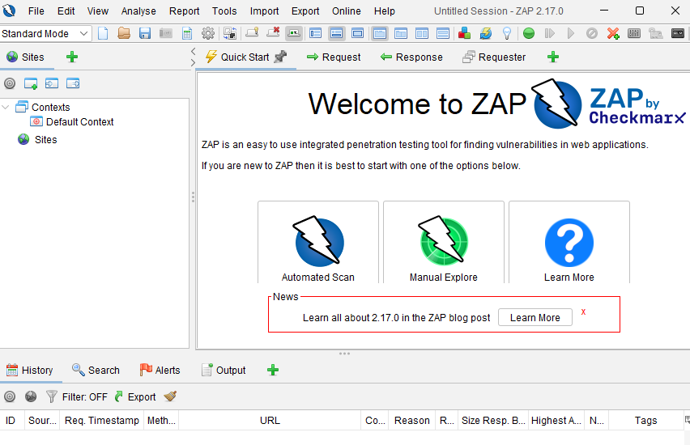
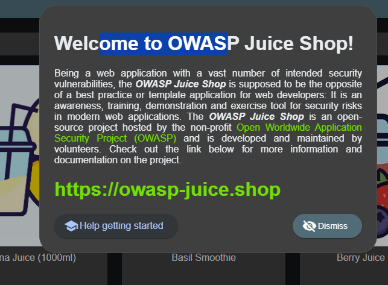
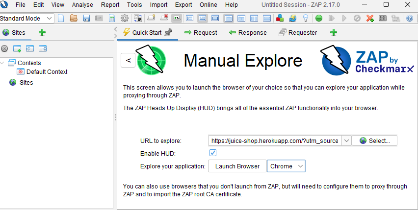
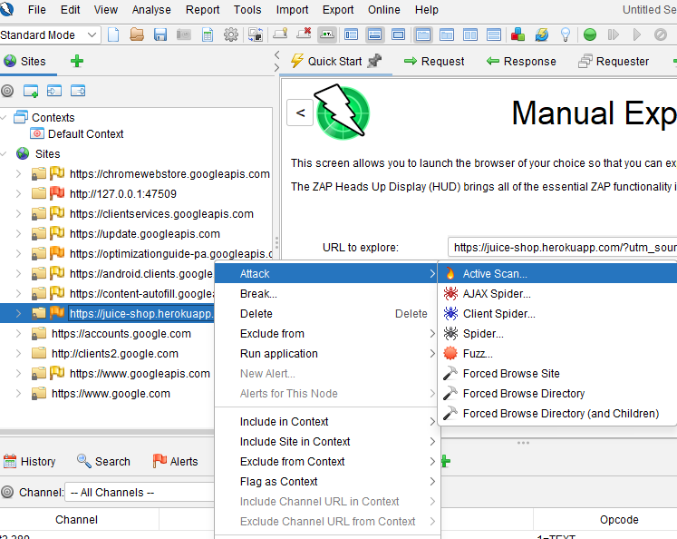
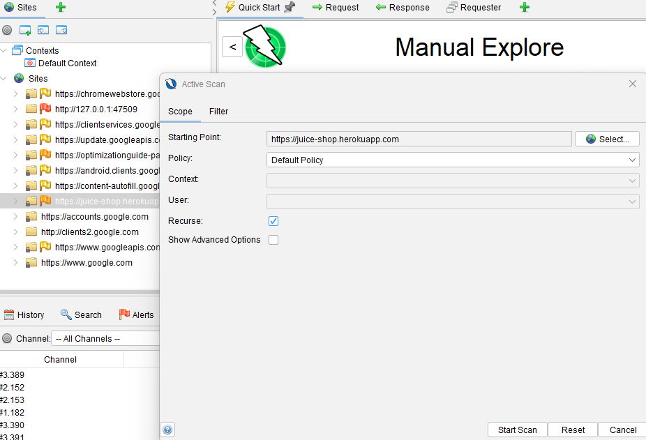
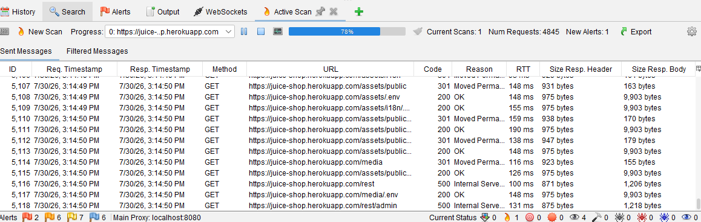
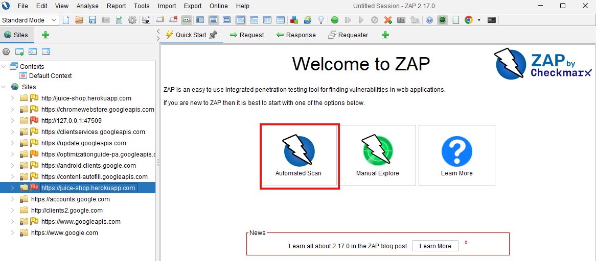
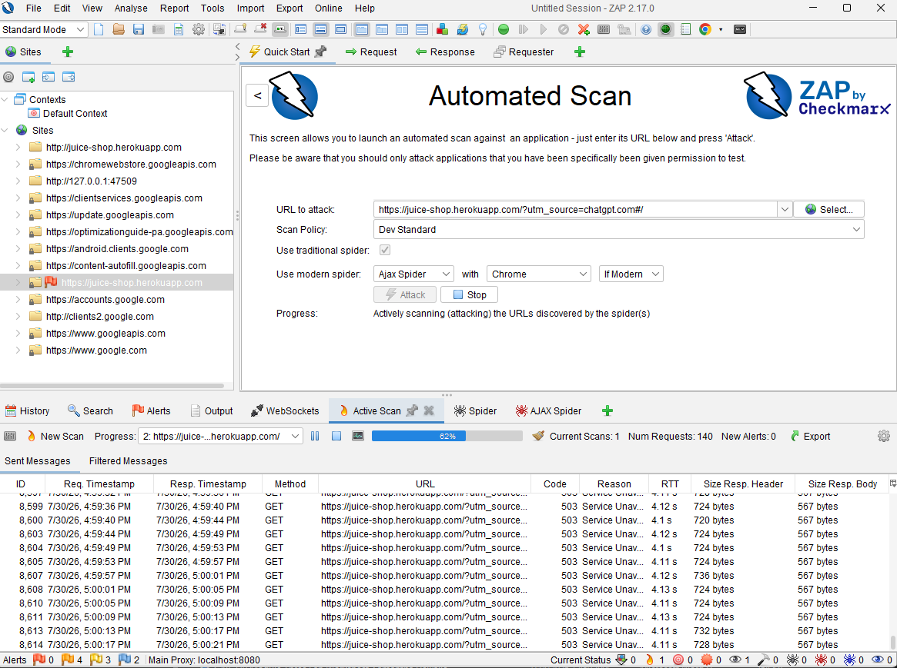
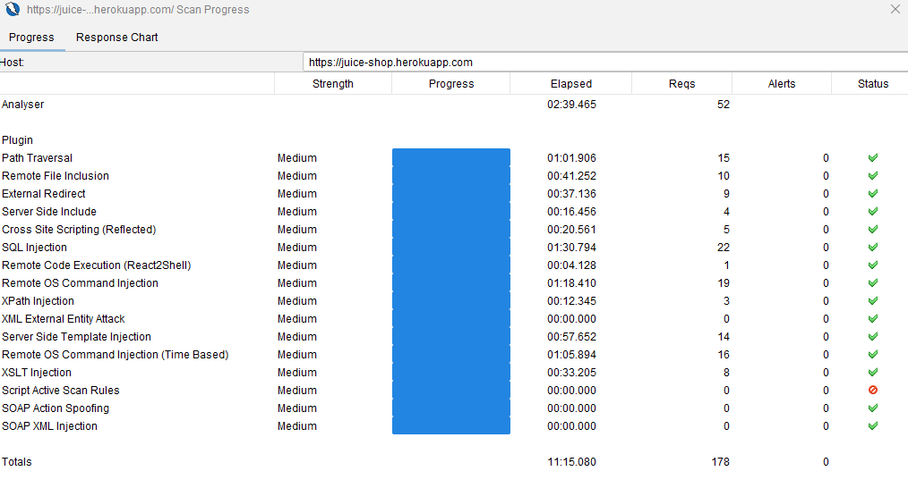
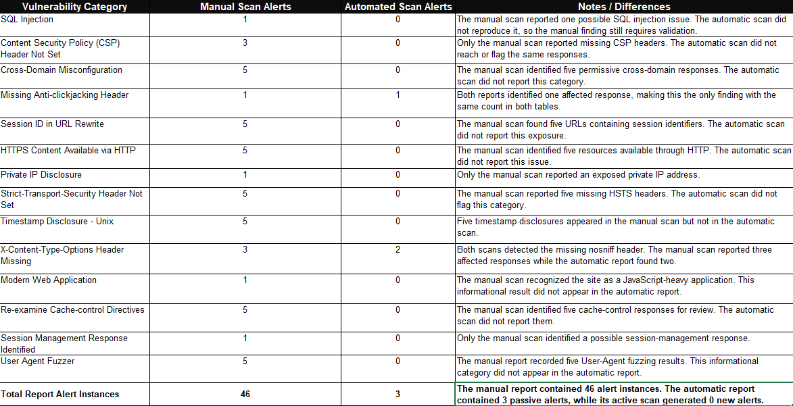

# Web Application Scanning with OWASP ZAP

## Overview

Manual exploration followed by active scanning produced 46 alert instances across 14 categories on OWASP Juice Shop. An automated run against the same application produced three passive alert instances and zero new active alerts. Understanding that difference became the central part of the assessment.

The automated scan completed most of its listed rules, but its request history showed repeated HTTP 503 Service Unavailable responses. Those responses, together with uncertainty about crawl coverage, limited what the absence of active findings could establish. The comparison therefore considered the responses received and the features reached, rather than judging either method by its alert count alone.

The strongest repeated findings involved missing browser security headers. A possible SQL injection alert in the product search parameter was rated High risk but Low confidence, making it a priority for validation rather than a confirmed exploit.

## Environment and Scope

* **Tool:** OWASP ZAP 2.17.0.
* **Browser:** Chrome launched through ZAP, with the Heads Up Display enabled.
* **Application:** OWASP Juice Shop, an intentionally vulnerable training application.
* **Methods:** Manual browser exploration, passive analysis, manually initiated active scanning, and an automated scan with spidering.

This write up documents the completed assessment of the hosted Juice Shop instance shown in the screenshots. It includes scan analysis and proposed remediation; application fixes and successful exploitation were not demonstrated.

## Investigation and Evidence

### 1. Establish the application and testing tool

ZAP was installed and launched before opening Juice Shop. Its intentionally vulnerable design made it useful for comparing scanner output with the evidence required to assess a finding.

**Screenshot 01: ZAP launch**

The application's welcome message identified it as a security training environment. This context helped frame the assessment as a learning exercise rather than a production security review.

**Screenshot 02: Juice Shop training application**

### 2. Route browser exploration through ZAP

Manual Explore launched Chrome through ZAP with the HUD enabled. Browsing supplied requests and responses for passive analysis and populated the Sites tree before active scanning.

The captured session also contained Chrome services, Google API traffic, and the local HUD tutorial. These were excluded from the reported Juice Shop findings. Traffic appearing in the proxy history did not automatically place it within the assessment scope.

**Screenshot 03: Manual Explore configuration**

### 3. Run an active scan against the selected application

The Juice Shop node was selected from the Sites tree, and the Active Scan option opened the scan configuration.

**Screenshot 04: Active scan selection**

The manually initiated scan used Default Policy with recursion enabled. Its starting point was the Juice Shop application, keeping the active scan focused on the selected target.

**Screenshot 05: Manual active scan configuration**

The request list showed application paths, HTTP response codes, and scan progress. Responses included both successful requests and server errors. The screenshot captures an in-progress scan; its request counter is not presented as a final total.

**Screenshot 06: Manual active scan progress**

### 4. Assess the manual findings by evidence and confidence

The documented manual assessment recorded **46 alert instances across 14 alert types**: 1 High, 14 Medium, 19 Low, and 12 Informational.

| Finding group | Instances | Assessment |
| --- | --- | --- |
| Possible SQL injection | 1 | The product search `q` parameter produced an HTTP 500 response to a test input. High risk, Low confidence; query manipulation was not verified. |
| Missing browser security headers | 7 | Three missing CSP, one missing anti-clickjacking protection, and three missing X-Content-Type-Options findings. |
| Cross-domain configuration | 5 | Wildcard Access-Control-Allow-Origin responses required review against the intended sharing policy. |
| Session ID in URL Rewrite | 5 | ZAP flagged URL values as session related. Their actual purpose and security significance required validation. |
| Transport security | 10 | Five HTTP availability findings and five missing HSTS findings. |
| Information disclosure | 6 | One private address disclosure and five Unix timestamp findings associated with the training application. |
| Informational results | 12 | Modern application behavior, cache-control review, a possible session-management response, and User-Agent fuzzing results. |

The SQL injection result warranted priority because of its potential impact. An HTTP 500 response alone did not establish that input changed a database query or exposed data.

Other alerts also needed application context. A wildcard CORS policy can be intentional for public responses, while a value classified as session related is not automatically an authentication token. Informational findings described behavior or review opportunities rather than confirmed vulnerabilities.

### 5. Configure and review the automated run

The Automated Scan workflow provided a second approach to discovery and testing.

**Screenshot 07: Automated scan selection**

The configuration showed **Dev Standard** policy, the traditional spider enabled, and **Ajax Spider with Chrome**, set to **If Modern**. This conditional selection did not by itself establish which application features the browser crawler successfully reached.

The visible request history repeatedly returned **HTTP 503 Service Unavailable**. That was a concrete limitation on the run. The evidence did not establish the cause of the service failures or show a successful retest after they cleared.

**Screenshot 08: Automated configuration and response errors**

The final progress window recorded:

* **11 minutes, 15 seconds** elapsed.
* **178 total requests**.
* **Zero new active alerts**.
* **15 of 16 listed rules showing completion**.

Several rules marked complete issued zero requests. A completion indicator therefore did not establish meaningful testing of every vulnerability class. The Script Active Scan Rules entry did not run; the notes recorded that no applicable scripts were enabled.

**Screenshot 09: Automated scan completion**

### 6. Compare the reports without overstating coverage

The automated report contained **three passive alert instances across two categories**: one missing anti-clickjacking protection and two missing X-Content-Type-Options headers. These were separate from the active scanner's zero new alerts.

| Measure | Manual assessment | Automated assessment |
| --- | --- | --- |
| Reported alert types | 14 | 2 |
| Reported alert instances | 46 | 3, all passive |
| Possible SQL injection | 1, Low confidence | Not reproduced |
| Missing anti-clickjacking protection | 1 | 1 |
| Missing X-Content-Type-Options | 3 | 2 |

Repeated header findings provided the clearest overlap between the reports. The missing SQL injection result in the automated report did not invalidate the manual alert or confirm it as a vulnerability.

Differences in discovery, scan policies, and responses limited direct comparison. The repeated 503 errors were visible evidence of an availability problem; incomplete coverage of dynamic routes remained a possible contributor rather than a verified root cause.

**Screenshot 10: Manual and automated findings comparison**

## Results and Lessons Learned

The assessment produced a categorized findings summary, a comparison of two scanning workflows, and recommendations tied to the reported evidence. It demonstrated why severity, confidence, and coverage need separate consideration.

The most useful lesson was to inspect the requests behind a scan result. Zero active alerts carried limited meaning when requests returned service errors or a completed rule sent no probes. Repeated header findings were more consistent than the unverified injection alert, while 46 alert instances did not represent 46 distinct exploitable vulnerabilities.

## Proposed Follow-up

These are possible extensions to the assessment, not completed fixes:

* Repeat testing on a locally controlled Juice Shop deployment and verify normal application responses before comparing scan outcomes.
* Validate the product search finding with controlled response comparisons and application or database logs where available.
* Compare discovered routes and input parameters between workflows, and review browser crawling and authentication coverage.
* Review CSP, anti-clickjacking protection, X-Content-Type-Options, HTTPS enforcement, and HSTS against the intended application behavior.
* Validate the purpose of URL values and cross-origin access before assigning impact or proposing session and CORS changes.
* Retest after any approved remediation and preserve request, response, and scan configuration evidence.