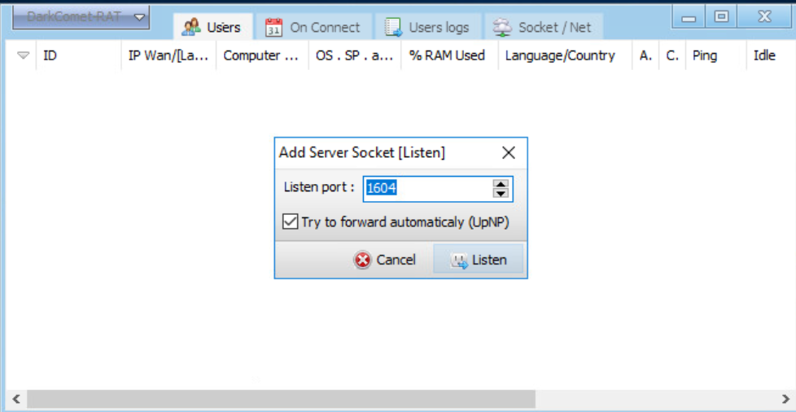
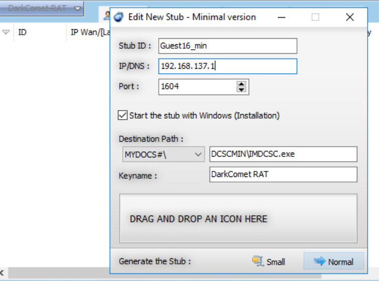

# Remote Access Trojan Configuration and Persistence Risk Analysis

## Overview

DarkComet's **Start the stub with Windows** option was selected in this lab. That setting made persistence the central security concern: a program configured to launch with the operating system could attempt to restore access after a restart, extending the risk beyond its first execution.

This authorized exercise used DarkComet in an isolated training environment to configure a listener and a test stub, the executable intended to connect back to that listener. The review focused on how the connection settings relate to each other, what automatic startup would mean for a defender, and which evidence would be needed to verify the resulting behavior.

The retained evidence covers configuration rather than a completed remote session or a restart test. That scope shaped the analysis: identify the intended behavior, then define how a defender could verify it.

## Lab Environment and Scope

* **Tool:** DarkComet RAT
* **Environment:** Authorized, isolated training lab
* **Network settings:** Lab provided connection address and port
* **Evidence:** Listener configuration and test stub configuration screenshots
* **Focus:** Connection setup, automatic startup, and defensive implications

The address visible in the screenshot belongs to the supplied lab configuration. No personal network details are included in the written analysis. This repository contains documentation and screenshots only.

## Configuration Review

### 1. Review the listener settings

The listener dialog showed port **1604**. The test stub used the same port, documenting consistency between the receiving side and the intended callback configuration.

Matching these values is only part of establishing communication. The receiving service must also be active and reachable from the endpoint. The screenshot shows the setup dialog and an empty host list, so it does not establish that a connection was received.

The **UPnP automatic forwarding** option was also selected. This identifies a requested configuration behavior, not a confirmed router change. No port mapping or external reachability test was recorded. For an isolated exercise, verifying the network boundary would be a useful follow up rather than assuming the interface setting proves where traffic can travel.

**Figure 1. DarkComet Listener Configuration**

### 2. Examine the test stub and startup settings

The stub configuration displayed a lab provided callback address and the same listening port. Together, these settings described where the executable was intended to establish its remote connection.

The selected **Start the stub with Windows** option introduced a separate persistence concern. A defender would need to investigate both the running process and whatever startup change was actually created. Ending a process alone would not establish that an automatic launch mechanism had been removed.

The interface also displayed an installation destination and an icon customization area. These settings help explain why a file's appearance is weak evidence of trust. However, the screenshot does not show a trusted application being impersonated, a user being deceived, or a security product being bypassed.

No endpoint startup entry or restart result was captured, so the specific persistence mechanism and its successful operation remain unverified.

**Figure 2. Remote Access Trojan Stub Configuration**

## Results and Lessons Learned

The documented result was a listener and stub configuration with matching ports and automatic startup selected. The review connected those settings to two distinct questions: whether an endpoint can establish a remote connection and whether it can resume that behavior after restarting.

The main lesson was the difference between configuration intent and observed behavior. A checked startup option explains what the program is intended to do. Process activity, endpoint changes, network records, and a controlled restart would provide evidence of what it actually did.

This also sharpened the defensive approach. A connection port alone would be a weak detection criterion. Investigating the executable, its origin, its startup behavior, and its network destination together would provide a more useful basis for deciding whether the activity is authorized.

## Proposed Defensive Follow Up

These are recommendations for extending the analysis. No control implementation or effectiveness test is documented in this project.

* **Endpoint visibility:** Review process creation, executable location, startup changes, and associated network activity to build a timeline of the behavior.
* **Application control:** Evaluate policies that restrict unauthorized executables using publisher signatures and other attributes rather than relying on filenames or icons.
* **Network controls:** Review outbound connection policy and verify that the training network cannot expose services beyond its intended boundary.
* **Delivery prevention:** Evaluate email attachment filtering and awareness practices for unexpected executables. Email delivery was not part of the documented exercise.
* **Persistence verification:** In an approved isolated test, record the startup changes and compare endpoint behavior before and after a restart. This would turn the selected option into a testable finding.