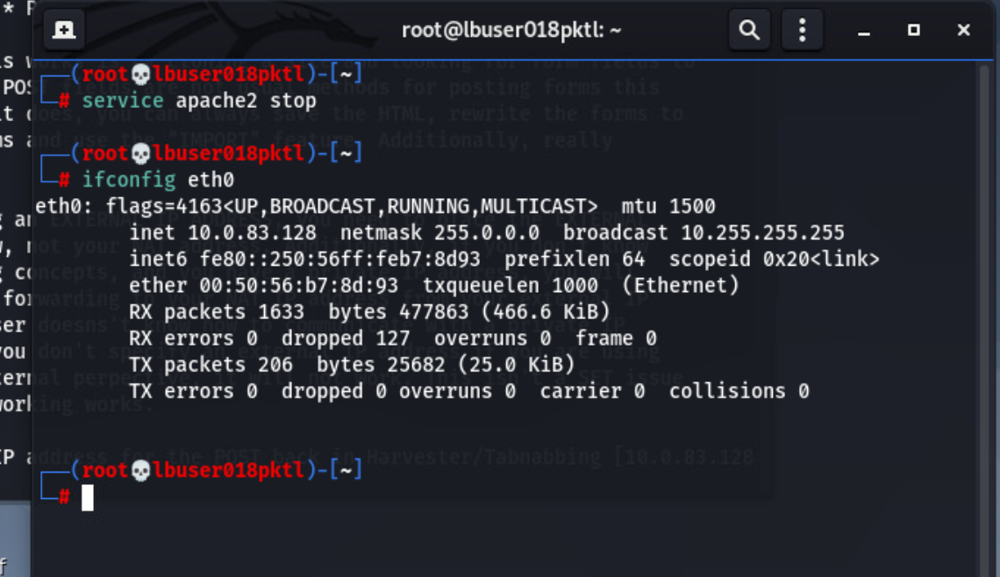
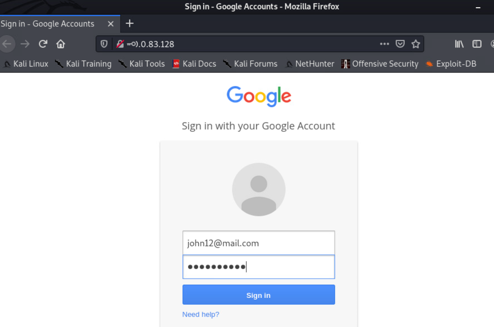
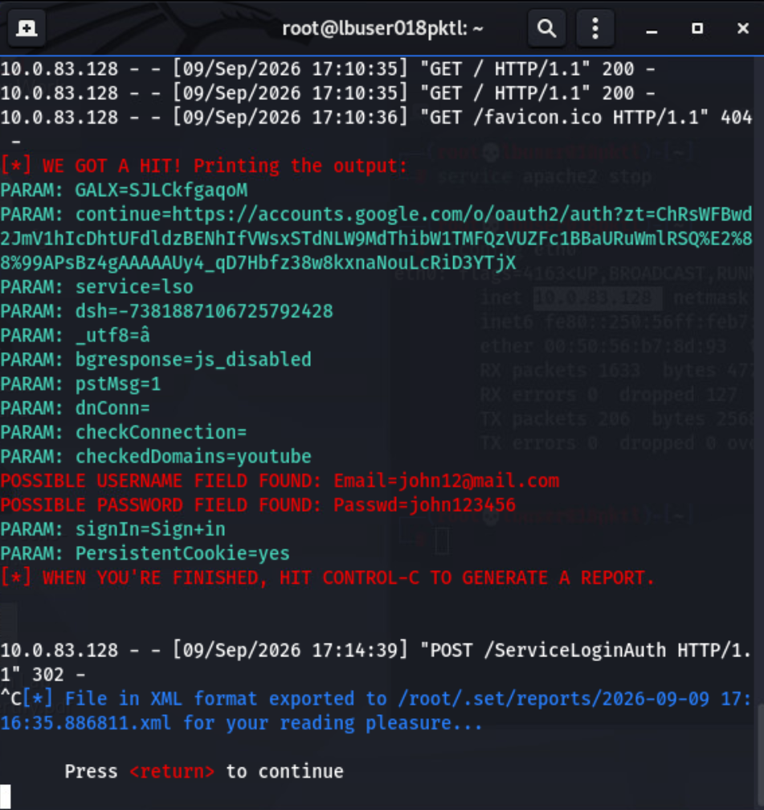

# Social Engineering and Credential Harvesting Simulation Using SET

## Overview

The password appeared as dots in the browser, but the submitted test value appeared as readable text in SET. That difference was the clearest result of this simulation: masking a password on screen does not stop the receiving website from collecting it.

A Google-style login page was hosted at a local lab address, and dummy credentials were submitted through the form. SET recorded the username and password fields, confirming that the information reached the simulation server. The familiar branding did not change the actual destination shown in the browser.

The exercise demonstrated the credential collection stage of a phishing scenario. It validated the local form submission and capture workflow, without measuring how often real users would trust the page or establishing access to an actual Google account.

## Environment and Scope

This was an **authorized training lab** using the **Social Engineer Toolkit, Kali Linux, Firefox, and dummy credentials**. The page and testing address were confined to the lab environment.

The screenshot addresses and host identifiers belong to the lab. The visible account and password values are dummy test data; their exact values are not repeated in the write up.

The documented work covered local setup, a simulated login form, captured form fields, and SET's report export message. It did not include an email campaign or a test of MFA controls.

## Investigation and Evidence

### 1. Prepare the local testing environment

The lab preparation included stopping Apache and reviewing the `eth0` interface with `ifconfig`. The interface output identified the local address used to host and access the simulated page.

This check connected the browser destination to the testing host. A page that looks correct is not enough to verify a setup; the address receiving the submission also needs to match the intended lab system.

**Screenshot 01: Local lab interface review**

### 2. Submit dummy credentials through the simulated page

Firefox displayed a login page with familiar Google branding, while the address bar pointed to the local lab system. The browser also displayed an insecure connection indicator.

Dummy account information was entered into the form. The password field concealed the typed characters on screen, providing a useful contrast with the readable value later shown by SET.

The domain mismatch was the stronger identity clue: the appearance of a sign-in page did not establish that it belonged to the service it represented. An HTTPS connection would also need that same destination check, since encryption alone does not establish that a website is trustworthy.

**Screenshot 02: Dummy credentials in the simulated login page**

### 3. Verify that SET received the submitted fields

SET's console identified the submitted `Email` and `Passwd` fields and displayed their dummy values. This confirmed receipt of the form data, rather than relying only on the browser's response after clicking Sign in.

The request output showed successful page requests, a form `POST`, and an HTTP `302` response. The redirect response did not establish successful authentication with the real service; the capture output was the evidence that the simulation had received the test information.

The console also reported an XML export to SET's reports directory. That message documented report generation, while the screenshot provided the visible evidence of the captured fields.

**Screenshot 03: Captured test fields and report export**

## Results and Lessons Learned

The completed workflow connected a locally hosted page, a controlled test submission, and visible capture output. One dummy username and password pair was documented in the console, together with the report export message.

The main lesson was to verify where information is going before entering it. A recognizable logo and a masked password field can make a form look familiar, but neither establishes who receives the submission.

The exercise also showed why a strong password alone does not resolve phishing risk. A convincing form can collect whatever password a user submits. Destination checks, authentication protections, and reporting procedures address different parts of that risk.

## Proposed Follow-up

These are possible extensions and defensive recommendations, not controls tested during this lab:

* Use phishing-resistant authentication, such as appropriately deployed FIDO/WebAuthn passkeys or security keys, where supported.
* Build awareness exercises around checking the actual sign-in destination and reporting suspicious pages, with approved scope and dummy data.
* Evaluate browser and web protection controls against approved simulation pages, and record whether the controls warn, block, or allow access.
* Define separate measures for page visits, form submissions, and user reports before evaluating a future awareness exercise.
* Treat capture reports as sensitive evidence, limit their access and retention, and keep real credentials out of test submissions.