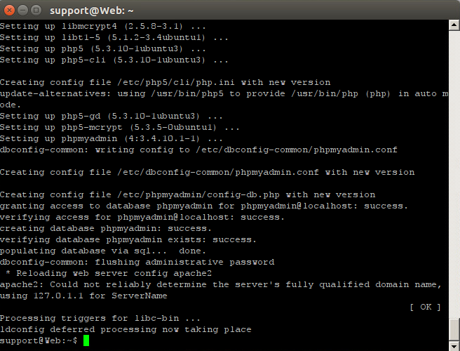
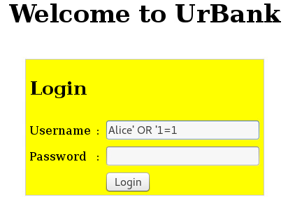
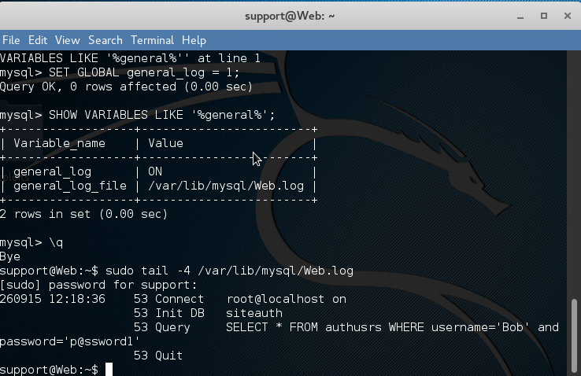
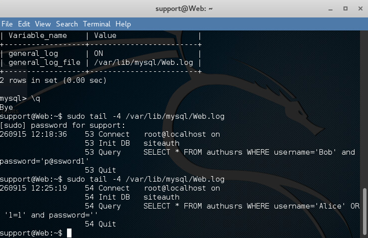
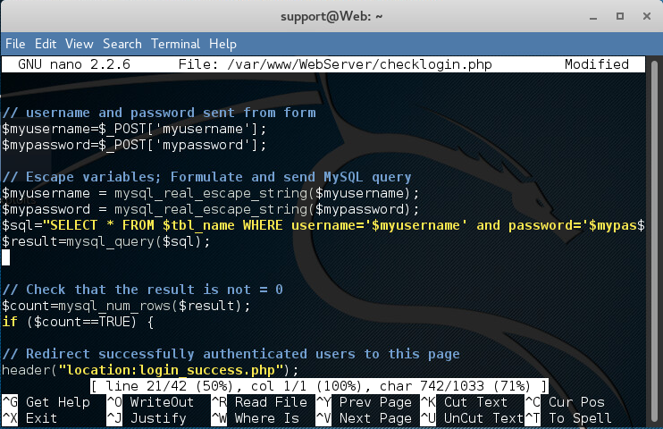
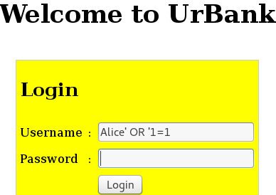
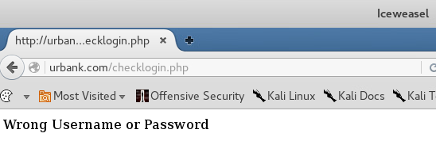
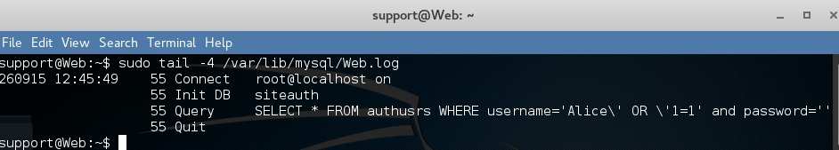

# SQL Injection Vulnerability Analysis and Mitigation

## Overview

The same username input produced two different results in this lab: **Login Successful** before the code change and **Wrong Username or Password** afterward. MySQL logs showed why. Before mitigation, the input introduced an `OR` into the authentication query. After escaping was added, its quotation marks remained inside the username value instead of changing the query structure.

This guided exercise used a simulated UrBank login application in a virtual environment to investigate an authentication bypass, compare normal and injected queries, modify the PHP login handler, and repeat the original test. Pairing the browser responses with database evidence made it possible to trace the result to how the application handled submitted input.

The implemented control blocked the documented bypass attempt. The broader lesson was to distinguish a successful retest from a complete security fix: the application still constructed SQL strings, and its legacy escaping function would need to be replaced with a maintained database API and parameterized queries in a modern implementation.

## Lab Environment and Scope

* **Application:** Simulated UrBank login page
* **Environment:** Virtual training web server and browser
* **Components:** Apache, legacy PHP, and MySQL
* **Analysis tools:** MySQL general query log, terminal, and GNU nano
* **Modified file:** `checklogin.php`
* **Test focus:** Username based SQL injection and authentication behavior before and after input escaping

The application address and account values shown in the screenshots belong to the training scenario. This project documents the supplied lab application rather than testing a public banking service. Test passwords are not repeated in the written analysis.

## Investigation and Mitigation

### 1. Prepare the virtual application

The setup output showed package configuration, successful database setup checks, and an Apache reload. Apache also reported that it could not reliably determine its fully qualified domain name and used a local address instead.

That warning did not establish a failed setup. The command returned to the prompt, and the later browser tests confirmed that the login application was accessible. No separate correction to the Apache warning was documented.

**Figure 1. Virtual Environment Setup Completed**



### 2. Establish the authentication bypass

The username field received the lab test input below while the password field was left blank:

```text
Alice' OR '1=1
```

The application displayed **Login Successful**. This established that the tested input could bypass the login check without Alice's valid password.

The retained browser evidence shows the success response. It does not demonstrate access to account balances, transactions, or other protected application functions.

**Figure 2. Successful SQL Injection Password Bypass**




### 3. Capture a normal authentication query

The MySQL general query log was enabled, and its status was checked. A normal credential submission for the lab user Bob produced a query against the `authusrs` table in the `siteauth` database.

The baseline query joined the username and password comparisons with `AND`. This provided a reference for the intended behavior: both submitted values should participate in the authentication check.

The log also exposed the submitted lab password as readable text. That was useful evidence during the exercise, but it identified a separate concern about collecting sensitive authentication data in diagnostic logs.

**Figure 3. Baseline Authentication Query**



### 4. Compare the baseline with the injected query

The injected submission produced this query in the log:

```sql
SELECT * FROM authusrs
WHERE username='Alice' OR '1=1' AND password=''
```

The important change was the new `OR` outside the username string. Because `AND` has higher precedence than `OR`, the password comparison belonged to the second branch. A row matching `username='Alice'` could satisfy the overall condition without also matching the supplied password.

This explains the bypass more precisely than describing the input as a condition that selected every account. The logged `'1=1'` is a quoted string, and the evidence supports a login bypass for this test rather than a claim that every database row was returned.

The root cause was user input being incorporated into SQL syntax. The browser showed the effect; the database log revealed the altered condition behind it.

**Figure 4. Comparison of Normal and Injected SQL Queries**



### 5. Apply the lab's input escaping control

The PHP login handler was edited to escape both submitted fields before building the query. The documented additions were:

```php
$myusername = mysql_real_escape_string($myusername);
$mypassword = mysql_real_escape_string($mypassword);
```

This changed how quotation marks in the input were represented when inserted into the SQL string. It was the control implemented in the guided exercise, not a conversion to prepared statements.

The function belongs to PHP's original MySQL extension, which was deprecated in PHP 5.5 and removed in PHP 7. The excerpt documents the historical lab change and is not a recommended implementation for a current application.

**Figure 5. Input Escaping Control Implemented**



### 6. Repeat the original test

The same username input was submitted again with the password blank. The application now displayed **Wrong Username or Password** instead of the success response.

Keeping the test input consistent provided a direct comparison across the code change. The result demonstrated that the implemented control blocked this specific authentication bypass attempt.

**Figure 6. SQL Injection Attack Blocked**





### 7. Verify the changed query in the log

The final log entry showed backslashes before the input's quotation marks. The supplied `OR` text remained within the escaped username value instead of becoming a separate SQL operator.

This added evidence beyond the rejection message. The browser confirmed the changed login outcome, while the database log showed that the input was represented differently in the query.

**Figure 7. Escaped SQL Query Verification**



## Results and Lessons Learned

| Stage | Browser result | Database evidence |
| --- | --- | --- |
| Before mitigation | Login Successful with the password blank | Input introduced an OR branch outside the username string |
| After mitigation | Wrong Username or Password for the same input | Quotation marks were escaped and the input remained inside the username value |

The strongest outcome was a verified change in one documented test case, supported by both browser behavior and query logs. No broader injection test suite or valid credential regression test was captured after the edit.

The main lesson was to inspect the generated query rather than relying on a familiar payload description. Operator placement and precedence explained why the password check could be bypassed. After mitigation, reviewing the query again helped explain why the same input stopped working.

The review also identified residual issues. The logged database connection used `root`, the authentication query included a readable password value, and the application continued to build SQL strings. Blocking the original input did not resolve those separate design concerns.

## Proposed Follow Up

* **Parameterize the query:** Move to a maintained PHP version and use MySQLi or PDO prepared statements so submitted values are bound separately from SQL structure. Escaping alone is a fragile general defense.
* **Verify normal login behavior:** Confirm that valid lab credentials still succeed, invalid credentials fail, and legitimate usernames containing special characters are handled correctly.
* **Expand regression testing:** Test both input fields and additional malformed values within the authorized lab, recording the browser response and relevant query evidence.
* **Reduce database privileges:** Replace the application's root connection with a dedicated account restricted to the operations it requires.
* **Improve password handling:** Use appropriate password hashing and verification rather than comparing readable passwords in the SQL query.
* **Protect diagnostic evidence:** Limit access to query logs, avoid retaining credentials, and disable verbose general logging when the investigation is complete.

These improvements were not implemented in the documented exercise. The completed mitigation was input escaping followed by a browser retest and database log verification.