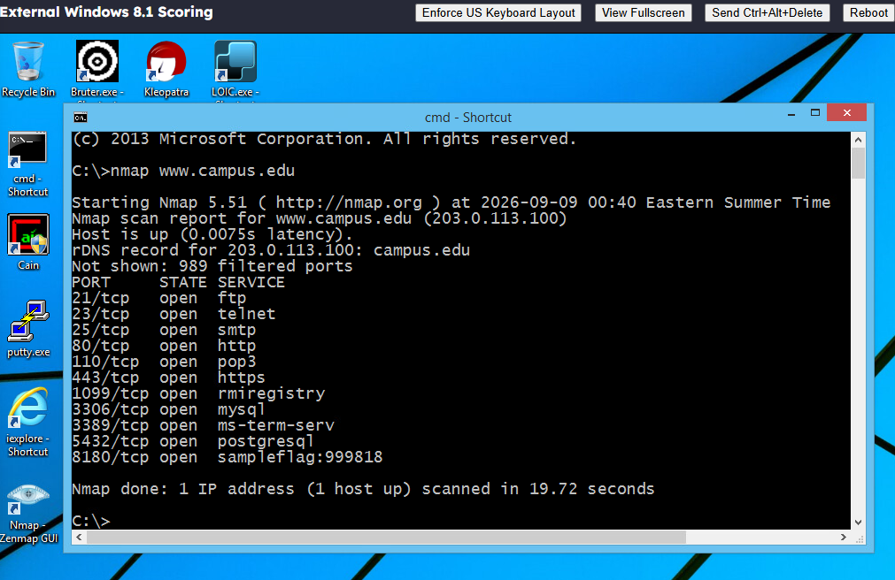
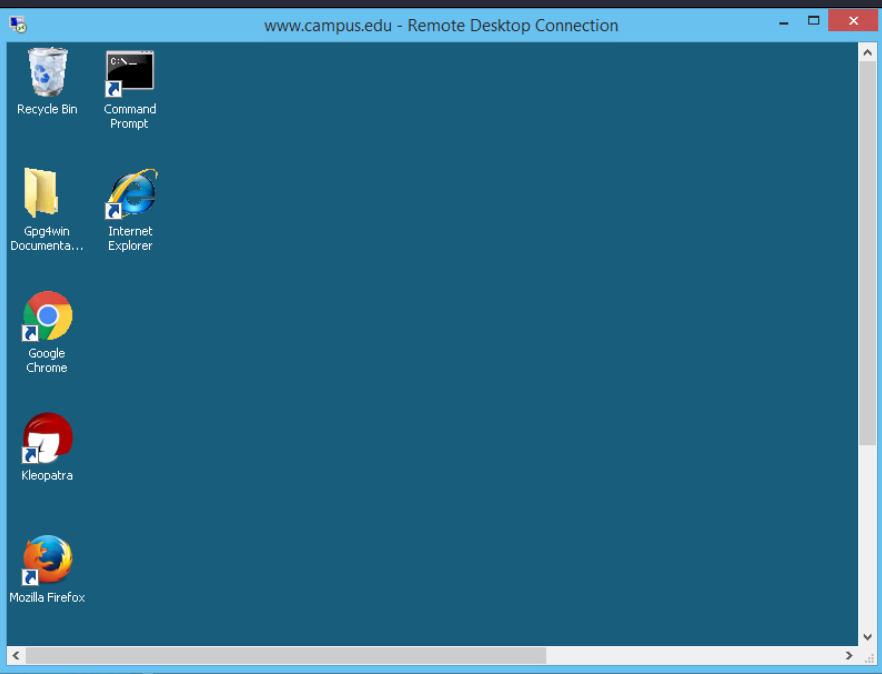
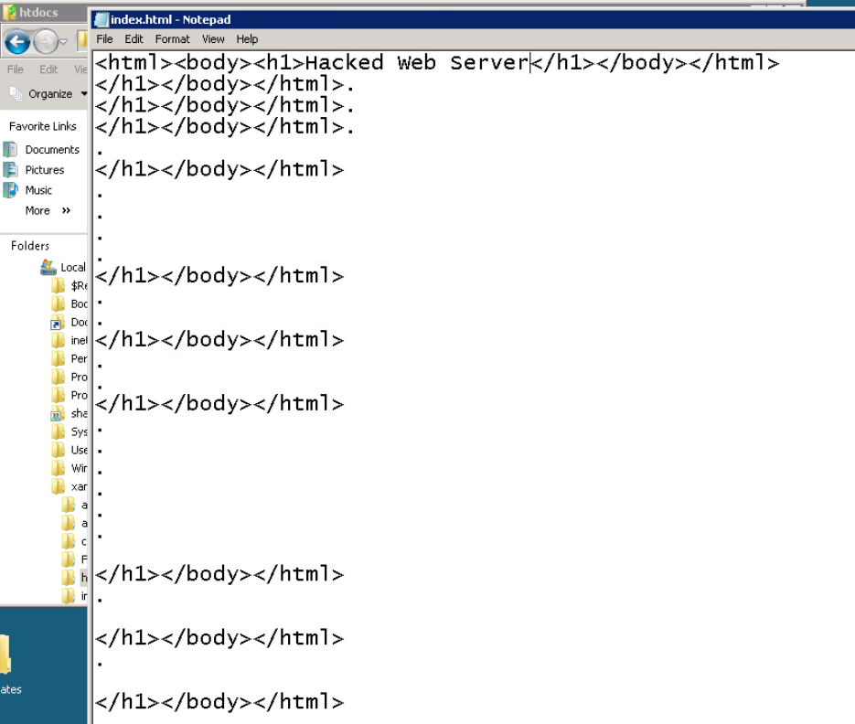
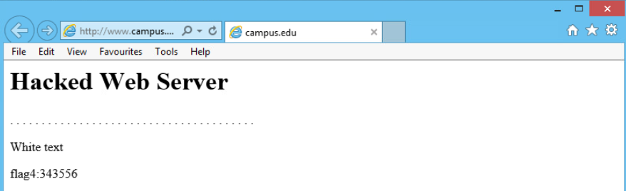
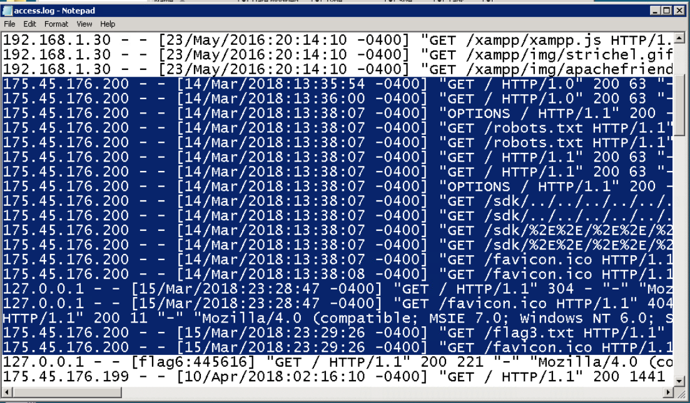
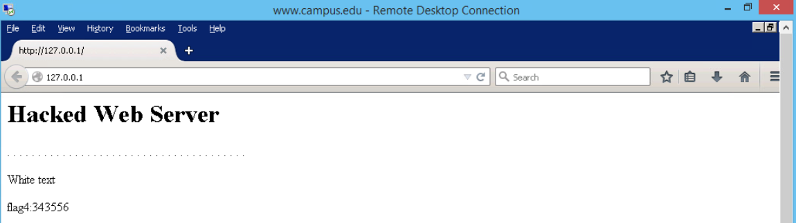

# Attacking Web Servers from the WAN

## Overview

The key finding was the reach of one compromised administrator account. In this guided lab, a dictionary password test against SMTP recovered credentials that were then accepted for Remote Desktop access. That session allowed the web server's `index.html` file to be changed, and a browser confirmed the new heading.

The work connected service discovery, authentication testing, remote access, and website integrity. It also examined how administrator access could affect local log evidence. A final browser check showed that the server continued serving the modified page, demonstrating that a functioning website can still contain unauthorized changes.

## Environment and Scope

This was a guided **CYB 240 Application Security lab** in a provided virtual environment. An external Windows 8.1 workstation represented the WAN side, and the lab's `campus.edu` hostname represented the simulated web server.

Tools included **Nmap 5.51, Zenmap, Bruter, Remote Desktop, Notepad, Apache, and web browsers**. Testing remained within the provided lab. Recovered credentials and the lab-console identifier are omitted from this portfolio package.

The documented outcome was access and content modification in the simulation. The defensive controls discussed below are recommendations, not changes implemented during the exercise.

## Investigation and Evidence

### 1. Identify externally reachable ports

The initial Nmap scan reported **11 open TCP ports and 989 filtered ports**, completing in **19.72 seconds**. The result identified several possible entry points, including mail services, remote administration, databases, and web services.

**Screenshot 01: WAN-side port discovery**

Zenmap service enumeration added application and version information to the port inventory:

| TCP port | Reported service or application |
| --- | --- |
| 21 | Microsoft FTP service |
| 23 | Telnet |
| 25 | hMailServer SMTP |
| 80 | Apache web service |
| 110 | hMailServer POP3 |
| 443 | Apache web service |
| 1099 | Java RMI Registry |
| 3306 | MySQL |
| 3389 | Microsoft Terminal Service / Remote Desktop |
| 5432 | PostgreSQL |
| 8180 | Apache Tomcat/Coyote JSP engine |

The first scan's label for port `8180` differed from the application identified by service detection. That reinforced the need to distinguish a port-based name from an application response. Version information supplied leads for investigation, but no software vulnerability was confirmed solely from a banner.

### 2. Evaluate the administrator credentials

Bruter used the provided wordlist in dictionary mode against the simulated administrator account through SMTP on port `25`. The tool reported a successful result.

This demonstrated that the lab password could be discovered from the supplied candidates. The result applied to this account and wordlist; it did not measure the strength of every account or establish which authentication protections were configured.

The recovered credential was subsequently accepted by Remote Desktop. This connected a weakness exposed through one service to access through another, increasing the consequence beyond the original password test.

### 3. Confirm remote access to the server

The recovered administrator credentials opened a Remote Desktop session to the simulated web server. This was a stronger result than simply observing an open RDP port: authentication succeeded, and the remote desktop was accessible.

**Screenshot 02: Remote Desktop access**

The session provided the access used for the next stage. No RDP protocol exploit was demonstrated; the connection relied on accepted credentials.

### 4. Modify the served webpage

The server's `index.html` file was opened in Notepad, and its heading was changed to **Hacked Web Server**.

**Screenshot 03: Webpage file modification**

Saving a file alone would not establish what a visitor received. Refreshing the site in a browser displayed the changed heading, confirming that the modified file affected the served page.

**Screenshot 04: Modified page in the browser**

This was a verified integrity impact: administrator access enabled the visible website content to be altered. The evidence did not demonstrate database access, data extraction, or a separate application exploit.

### 5. Examine local log evidence and its limitations

The Apache access log contained HTTP requests associated with the simulated external system. Visible records included `GET` and `OPTIONS` requests, requested paths, timestamps, and response status codes.

**Screenshot 05: Apache access log review**

The screenshot contained historical timestamps predating the lab session. These records illustrated the supplied log evidence and its structure; they were not treated as a verified timeline of the current exercise. Apache access records also did not, by themselves, prove the SMTP password test or RDP login.

The guided exercise included removing selected entries from the local log. This highlighted a second integrity concern: administrative access could affect both website content and evidence stored on the same server. The screenshot shows the selected records before editing, not proof that every trace of activity was removed.

### 6. Verify local server operation

After the documented log changes and Apache restart, the site was tested through the server's loopback address. The browser loaded the page and continued displaying the modified heading.

**Screenshot 06: Local server verification**

This confirmed that Apache was serving content locally after the changes. It did not establish that the site had been restored or that the server was secure. Availability and content integrity were separate outcomes in this test.

## Results and Lessons Learned

The completed lab demonstrated a sequence from **11 reachable TCP ports** to a successful dictionary password test, authenticated Remote Desktop access, and a browser-verified webpage change. The final local test confirmed that the server continued operating with the modified content.

The most useful lesson was how the controls depended on one another. Discovering a password through SMTP mattered more because the credential also allowed remote administration. Once that access was available, both the web file and local log records could be changed.

The exercise also reinforced the need to match each conclusion to its evidence. An open port showed reachability, a successful remote session showed access, and the browser showed the effect of the file edit. Historical log entries and a working webpage answered different questions and could not substitute for authentication records or integrity checks.

## Recommended Follow-up

These are proposed defensive improvements, not completed remediation:

* Review why each service needs WAN access, remove unnecessary exposure, and restrict administrative and database services to intended systems.
* Use long, unique passwords, reject commonly used or compromised values, and limit repeated authentication attempts. Review account separation across services.
* Protect remote administration with restricted access and a supported MFA design, while limiting which accounts can administer the server.
* Apply least privilege to website files and monitor content changes so unauthorized edits can be detected even while the site remains available.
* Protect log permissions and retain copies outside the server's administrative boundary. Correlate HTTP, authentication, and remote-access records when investigating an incident.