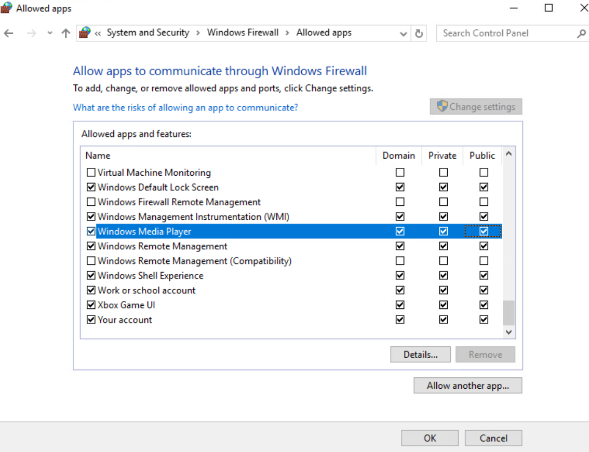
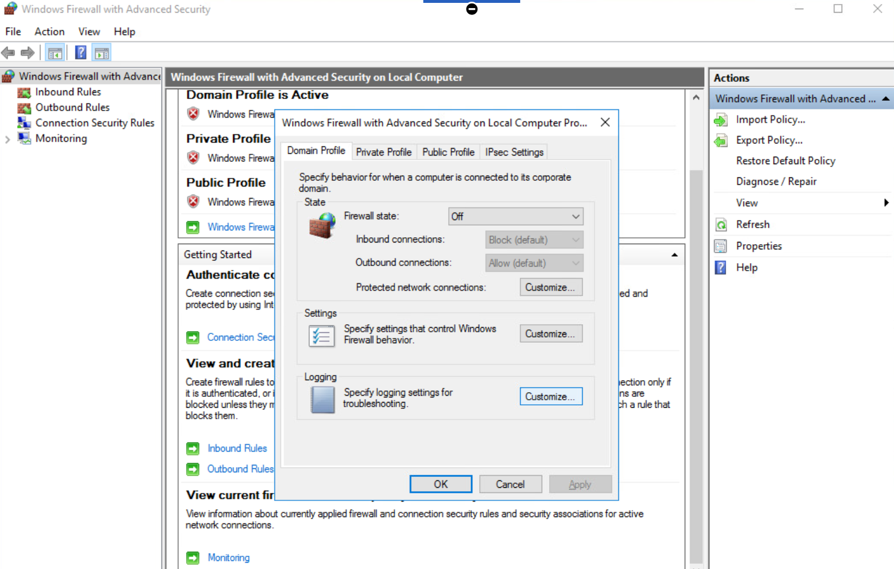
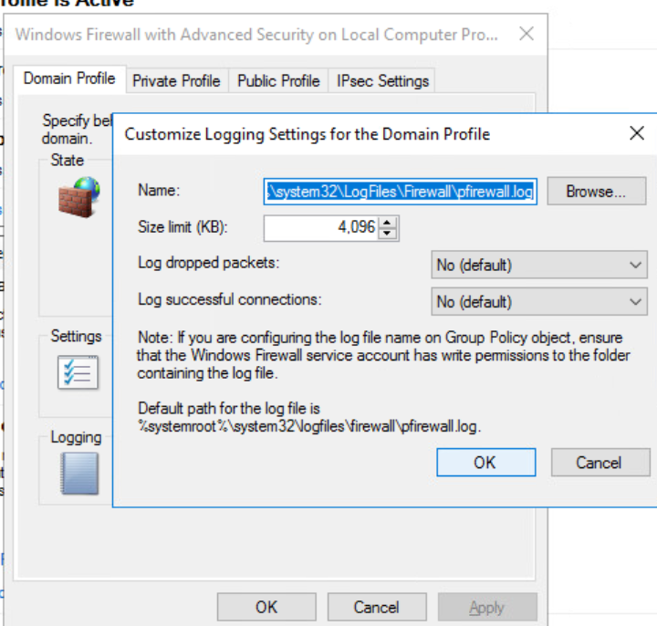

# Windows Firewall Configuration and Logging

## Overview

The firewall had a log path and a **4,096 KB** size limit configured, while both packet logging options remained set to **No**. The active Domain profile also showed **Firewall state: Off**. Reviewing those values together exposed the gap between stored settings and an enabled security control.

This guided lab covered an application exception for Windows Media Player and a review of Windows Firewall's Domain Profile logging settings. The application screenshot showed Domain, Private, and Public selected. The advanced properties then provided the evidence needed to check firewall state, log capacity, and whether activity recording was enabled.

The completed work documented the application permissions and verified the displayed logging settings. It did not demonstrate active firewall enforcement or generated packet log entries. The main value of the review was identifying what still needed to be enabled and tested before claiming effective filtering and monitoring.

## Lab Environment and Scope

* **Environment:** Windows training system
* **Interfaces:** Control Panel Allowed apps and Windows Firewall with Advanced Security
* **Application:** Windows Media Player
* **Logging profile reviewed:** Domain
* **Evidence:** Three configuration screenshots

The screenshots contain configuration settings rather than personal network addresses or captured user traffic.

## Configuration Review

### 1. Review the application exception

Windows Media Player was selected in the list of applications allowed through Windows Firewall. The lab notes focused on Private and Public network access, and the screenshot also showed the Domain checkbox selected.

This documented the exception's profile coverage. It did not show the underlying ports, the application's listening state, or a successful connection from another host.

Profile selection matters because the same application may need different access depending on the network context. Public network permission would deserve a separate access requirement review rather than being treated as interchangeable with Private access.

**Figure 1. Allowing Windows Media Player Through Windows Firewall**



### 2. Inspect the active profile and firewall state

The advanced firewall console identified the **Domain Profile as active**. Its properties showed **Firewall state: Off**, with the inbound and outbound default action fields greyed out.

This was an important finding when interpreting the application exception. Selected permissions describe stored configuration, but they do not establish that Windows Firewall was filtering traffic under the displayed profile.

The **Customize** button in the Logging section provided access to that profile's recording settings. No later screenshot showed the Domain firewall being turned on.

**Figure 2. Accessing Windows Firewall Logging Settings**



### 3. Verify log capacity and recording options

The logging dialog displayed the default firewall log location and a maximum size of **4,096 KB**, approximately **4 MB**.

```text
%systemroot%\system32\LogFiles\Firewall\pfirewall.log
```

The same dialog showed that neither logging category was enabled:

| Domain Profile logging setting | Displayed value |
| --- | --- |
| Maximum log size | 4,096 KB |
| Log dropped packets | No (default) |
| Log successful connections | No (default) |

The size value establishes a capacity limit, not how much data the file contains. A path and size limit alone do not enable packet logging. The retained evidence shows these options being inspected, with no subsequent change to Yes or review of log contents.

**Figure 3. Verifying the Firewall Log Size Limit**



## Findings and Lessons Learned

The review established three findings:

* Windows Media Player's exception was selected for **all three network profiles**.
* The **active Domain profile's firewall was Off** in the captured properties.
* The Domain log had a **4,096 KB limit**, with **dropped packet and successful connection logging both set to No**.

The main lesson was to verify control state alongside configuration values. An application exception, an active network profile, an enabled firewall, and enabled logging are separate conditions. Seeing one of them does not establish the others.

This also shaped the next troubleshooting step. Before interpreting an empty or unchanged packet log, first confirm the firewall state, the correct profile's logging options, and whether a controlled test should generate an entry. Increasing the file size would not resolve disabled recording.

Once logging is enabled, retention becomes a separate concern. The file size limits how much local evidence can be retained, and older entries are removed as new ones arrive after the limit is reached. No retention duration or traffic volume was measured in this exercise.

## Proposed Follow Up

* **Verify enforcement:** In an approved lab test, enable the required firewall profile and confirm its state before assessing an application exception.
* **Review application scope:** Determine which profiles Windows Media Player actually requires and inspect the associated rules before narrowing permissions.
* **Enable recording:** Turn on dropped packet and successful connection logging for the profiles included in the test.
* **Generate evidence:** Run controlled allowed and blocked traffic tests, then match their timestamps and network details to entries in the packet log.
* **Review retention:** Evaluate log capacity against expected activity and preserve relevant entries before rollover. Microsoft's current guidance recommends at least 20,480 KB for local firewall logs.

These are proposed improvements. The documented lab verified settings and identified gaps; it did not complete an enforcement or logging retest.