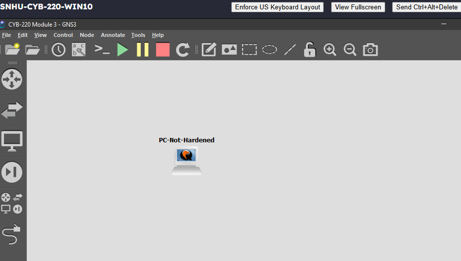
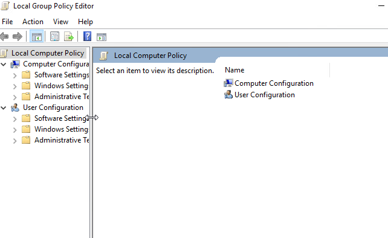
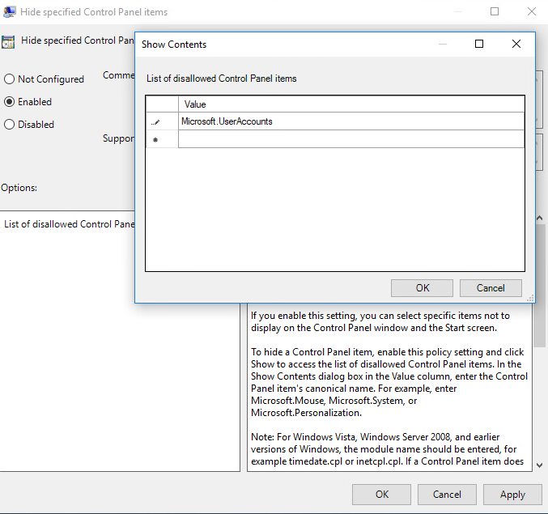
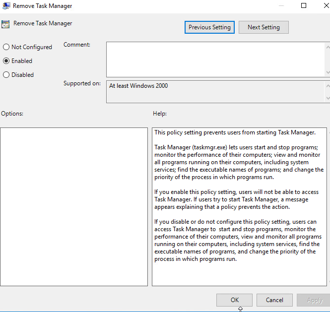
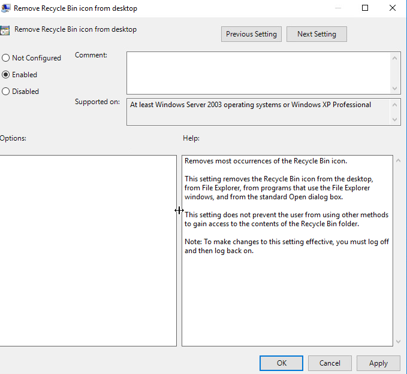
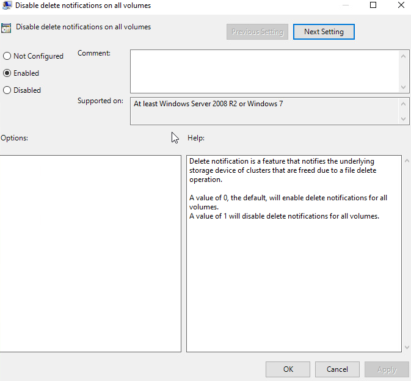
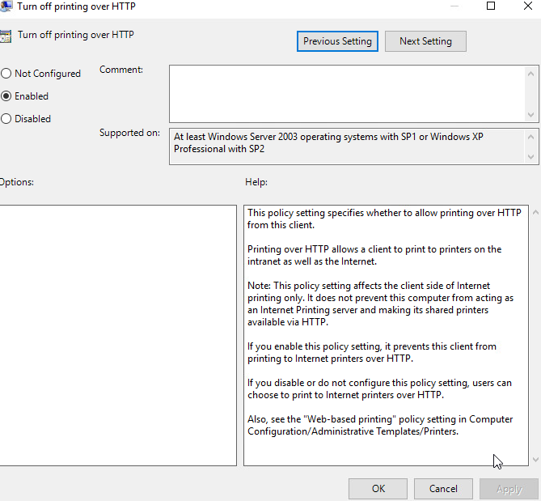
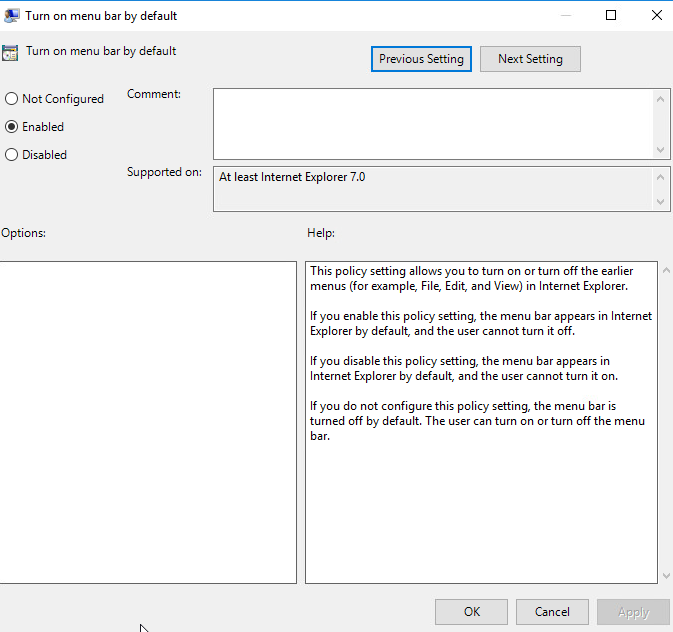

# GNS3 Windows Group Policy Security Hardening Lab

## Overview

Enabling **Remove Task Manager** restricts a user tool, while enabling **Turn on menu bar by default** makes a browser feature visible. This lab made policy names and scope essential to understanding what **Enabled** actually changes.

The guided exercise used the **PC-Not-Hardened** Windows workstation in GNS3 to configure six Local Group Policy settings. The work covered access to selected user interfaces, storage delete notifications, client printing over HTTP, and Internet Explorer's menu bar.

The review focused on the purpose and limits of each setting. Hiding a Control Panel item does not replace account permissions, and removing the Recycle Bin icon does not protect its contents from every access method. The screenshots document Enabled selections and the required Control Panel value; effective policy reporting and behavior tests would be the next validation stage.

## Lab Environment and Scope

* **Platform:** GNS3
* **Workstation:** PC-Not-Hardened
* **Tool:** Local Group Policy Editor
* **Policy areas:** Computer Configuration and User Configuration
* **Scope:** Local policy configuration on one Windows training workstation
* **Evidence:** Eight screenshots covering the environment, editor, and six policy settings

The six settings were required by the guided lab. Their inclusion documents the exercise rather than establishing a complete security baseline for a production workstation.

## Configuration and Analysis

### 1. Identify the workstation

The GNS3 workspace contained the workstation named **PC-Not-Hardened**. This established the system used for the policy exercise and kept the configuration work within the virtual training environment.

**Figure 1. GNS3 Environment Containing the PC-Not-Hardened Workstation**



### 2. Open the Local Group Policy Editor

The editor displayed **Local Computer Policy**, with Computer Configuration and User Configuration available. That distinction matters when interpreting a policy: a computer setting concerns the device, while a user setting concerns the applicable user environment.

The retained screenshot establishes the local editor used for configuration. It is not an effective policy report showing the final settings applied to a user session.

**Figure 2. Local Group Policy Editor on the PC Not Hardened Workstation**



### 3. Hide the User Accounts Control Panel item

**Hide specified Control Panel items** was set to Enabled, and the disallowed items list contained:

```text
Microsoft.UserAccounts
```

The canonical name identifies the specific Control Panel item targeted by the policy. This is more precise than using a general instruction to hide account settings.

The expected effect is to remove that item from the relevant interface. Account management permissions remain a separate control, so hiding the item would not establish that every method of changing an account is blocked.

**Figure 3. Hide Specified Control Panel Items**



### 4. Restrict Task Manager access

**Remove Task Manager** was set to Enabled. The policy description states that users subject to it cannot start Task Manager and receive a policy restriction message if they try.

This controls access to a particular tool. It does not establish that a user cannot inspect or influence processes through any other authorized method. Restricting Task Manager also affects routine troubleshooting, so its use would need to fit the workstation's purpose and support process.

**Figure 4. Remove Task Manager Policy**



### 5. Remove the Recycle Bin icon

**Remove Recycle Bin icon from desktop** was set to Enabled. Its help text describes removing the icon from several interfaces, including the desktop and File Explorer, while explicitly stating that other methods can still access the Recycle Bin folder's contents.

That limit is important: changing interface visibility does not establish deleted file confidentiality. The same help text requires signing out and signing back in for the change to become effective. No resulting desktop or access test after that step was captured.

**Figure 5. Remove Recycle Bin Icon From Desktop**



### 6. Disable storage delete notifications

**Disable delete notifications on all volumes** was set to Enabled. Here, a delete notification tells an underlying storage device which clusters have been freed by a file deletion.

This setting concerns storage behavior. It is not a policy for removing deletion confirmation prompts or disabling audit records, and it does not prevent files from being deleted.

The exercise demonstrates the selected configuration. A production decision would require a storage specific reason and an assessment of its effects rather than assuming that disabling a feature automatically strengthens security.

**Figure 6. Disable Delete Notifications on All Volumes**



### 7. Turn off client printing over HTTP

**Turn off printing over HTTP** was set to Enabled. The policy's intended effect is to prevent the client from printing to Internet printers over HTTP, including printers reached through an intranet or the Internet.

The help text defines a narrower scope than disabling every printing function. It affects the client side of Internet printing and does not prevent the computer from acting as an Internet Printing server. No printer connection or printing test was retained.

**Figure 7. Turn Off Printing Over HTTP**



### 8. Standardize the Internet Explorer menu bar

**Turn on menu bar by default** was set to Enabled. The description specifies that Internet Explorer's menu bar appears by default and the user cannot turn it off through the affected setting.

This is an interface consistency policy for a legacy browser. Its documented purpose does not establish protection against malicious websites, scripts, or downloads. Distinguishing interface standardization from security enforcement keeps the significance of the setting clear.

**Figure 8. Turn On Menu Bar by Default**



## Results and Lessons Learned

The retained evidence documented **six policy settings with Enabled selected** and **one canonical Control Panel item** in the disallowed list. It did not include a Resultant Set of Policy report or subsequent user behavior tests.

The main lesson was to read each policy's behavior and limits before interpreting its state. Enabled can activate a restriction, disable a named feature, or require something to remain visible. The effect comes from the policy definition, not the checkbox alone.

The Recycle Bin and HTTP printing descriptions were especially useful because both identified limits that a short policy name could obscure. One leaves alternative access to folder contents; the other affects client printing without disabling the server role.

A stronger validation would connect each configuration to an observable result. That would separate a recorded policy selection from confirmed behavior in the intended user session and provide a clearer basis for deciding whether the restriction fits the workstation's role.

## Proposed Follow Up

* **Verify effective policy:** Generate a `gpresult` report for the workstation and relevant user, then compare it with the configured settings.
* **Test expected behavior:** Check Control Panel visibility, the Task Manager restriction message, and Recycle Bin visibility after the required sign out and sign in.
* **Check policy scope:** Record whether each configured setting applies through Computer Configuration or User Configuration and identify the users affected.
* **Review operational impact:** Evaluate how the restrictions affect support tasks, storage behavior, printing requirements, and browser usability.
* **Prepare rollback evidence:** Document the original policy states and how to restore them, then test any further changes in the virtual lab before broader use.

These are proposed extensions. No additional policy deployment or behavior validation is claimed in the documented exercise.    