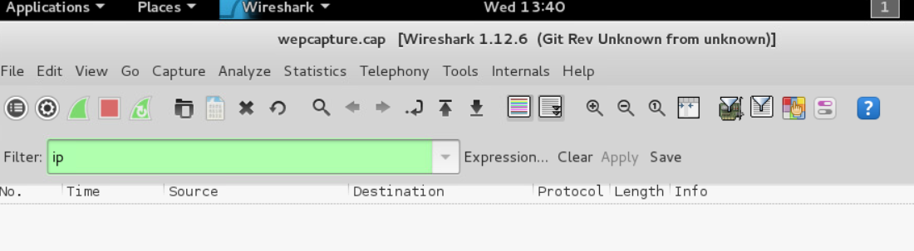
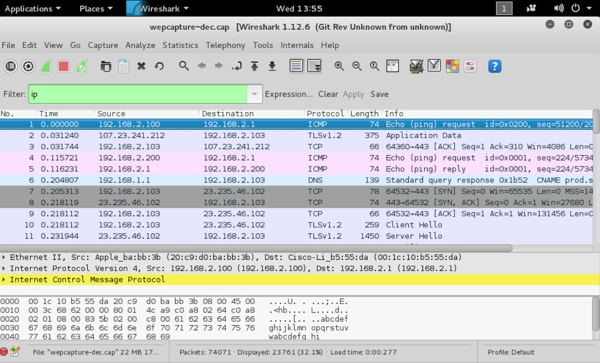
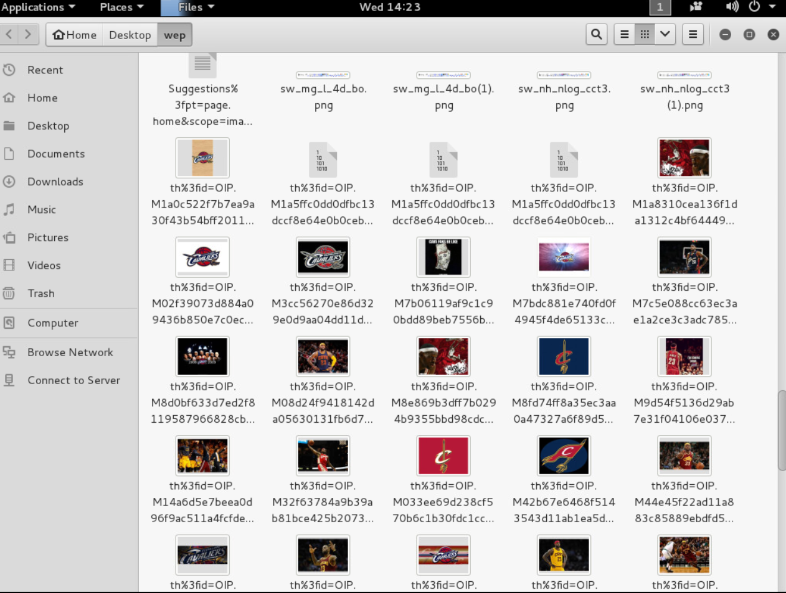
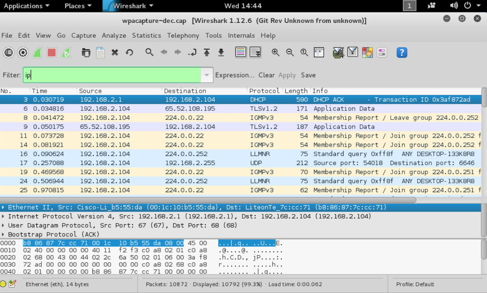
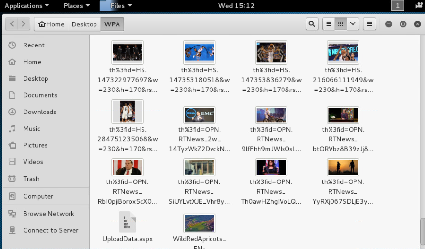

# Wireless Security Assessment: WEP and WPA Traffic Decryption

## Overview

Recovering the wireless keys made more than network addresses visible. In two supplied lab captures, decrypted traffic exposed plaintext mail credentials, a readable email, and web content that could be exported into files. The assessment connected wireless protection failures with the information carried by the applications using that network.

The WEP and WPA results had different causes. The WEP key was recovered from captured data using Aircrack-ng's analysis, while the WPA passphrase was found through a wordlist after 24,184 candidate tests. The WPA result demonstrated a guessable passphrase in this sample, rather than proving that every WPA-protected network could be decrypted by the same method.

The most useful distinction was between wireless encryption and application encryption. Recovering a wireless key exposed the unencrypted POP and HTTP content in these captures. TLS packets were also visible, but TLS payload decryption was not demonstrated.

## Environment and Scope

This lab analyzed **two supplied capture files**, one WEP and one WPA, in a Kali Linux environment. The workflow used **Aircrack-ng 1.2 rc2** and **Wireshark 1.12.6**, including display filters, Follow TCP Stream, and HTTP object export.

The work covered offline key recovery and analysis of existing traffic. The packet addresses and device identifiers shown in the evidence belong to the supplied training data. Recovered keys, credentials, and the email image are excluded from the public screenshot package.

## Investigation and Evidence

### 1. Establish the encrypted WEP baseline

The original WEP capture was opened in Wireshark and viewed with the `ip` display filter. No matching decoded IP packets appeared in that view.

The empty filtered result did not establish that the capture contained no traffic. It showed that Wireshark was not displaying readable IP traffic under those conditions. Keeping the same filter for the decrypted file provided a useful comparison.

**Screenshot 01: Encrypted WEP capture**

### 2. Recover the WEP key and verify the decoded traffic

Aircrack-ng reported **35,159 initialization vectors** and successfully recovered the WEP key. Its output indicated that the recovered key passed the tool's decryption check.

WEP recovery relies on weaknesses in its encryption design and information available in captured packets. This differed from the wordlist method used later against WPA.

The decrypted file, `wepcapture-dec.cap`, was then opened in Wireshark. Applying the same `ip` filter displayed **23,761 packets out of 74,071 packets in the file**. Visible protocols included ICMP, DNS, TCP, and TLS.

The readable network fields provided evidence beyond the tool's key-found message: the recovered key had enabled analysis of traffic in the decrypted output.

**Screenshot 02: Decrypted WEP traffic**

### 3. Examine application content in the WEP capture

Following a POP TCP stream exposed a username and password in plaintext. This identified an application-level confidentiality problem in addition to the weak wireless protection. Once the wireless layer was decrypted, the mail exchange had no effective encryption protecting those credentials in the inspected stream.

HTTP object export also recovered files transferred during the captured browsing session. The output folder contained images and other web objects that could be inspected independently of the packet list.

**Screenshot 03: WEP HTTP object export**

The results showed two forms of exposure: readable authentication data and reconstructed web content. They did not demonstrate use of the recovered mail credentials to sign in to an account.

### 4. Test the WPA passphrase and inspect the decrypted file

Aircrack-ng used a wordlist against the supplied WPA capture. The successful result appeared after **24,184 candidate keys tested**, with **12 seconds** shown by the tool's elapsed-time counter.

These were offline candidate tests against captured authentication data, not 24,184 online login attempts. Success depended on a matching passphrase being present in the wordlist. The result applied to this capture and test setup; it was not a general cracking-time estimate for other networks.

The recovered passphrase enabled the decrypted file, `wpacapture-dec.cap`, to be inspected in Wireshark. The `ip` filter displayed **10,792 packets out of 10,872 packets in the file**, including DHCP, IGMP, LLMNR, UDP, and TLS traffic.

**Screenshot 04: Decrypted WPA traffic**

### 5. Review readable mail and exported WPA web content

Follow TCP Stream revealed a readable email in the decrypted POP traffic. This showed that message content, as well as login data, could be exposed when application traffic was unencrypted.

HTTP object export recovered additional web content, including images from the captured browsing session. The exported files demonstrated that analysis could reconstruct transferred content rather than stop at identifying protocols and endpoints.

**Screenshot 05: WPA HTTP object export**

### 6. Compare the results and their meaning

| Measure | WEP capture | WPA capture |
| --- | --- | --- |
| Recovery evidence | Key recovered; 35,159 IVs reported | Passphrase matched after 24,184 candidate tests |
| Packets in the decrypted file | 74,071 | 10,872 |
| Packets displayed by `ip` | 23,761 | 10,792 |
| Plaintext application evidence | POP login credentials and HTTP objects | POP email content and HTTP objects |

The displayed packet counts measured what matched the `ip` filter. They were not percentages of successfully cracked traffic, and the differing capture sizes did not provide a controlled comparison of WEP and WPA performance.

TLS records appeared in both decoded packet views. Identifying TLS traffic did not establish that its protected application content was readable. Wireless decryption and TLS decryption require different key material, so the plaintext findings were limited to the inspected POP and HTTP content.

## Results and Lessons Learned

The lab completed key or passphrase recovery for both supplied captures, verified readable network traffic in the decrypted files, inspected plaintext mail exchanges, and exported HTTP objects.

The main lesson was that protection needed to exist at more than one layer. WEP's design weakness and a guessable WPA passphrase created different paths to readable wireless traffic. Unencrypted mail and web communication then exposed data that stronger application encryption could have continued protecting.

The initial empty `ip` view also reinforced the importance of checking what a result actually represents. A filter with no matches did not mean there was no captured activity. Reusing the filter after decryption made the change in visibility clear.

## Recommended Follow-up

These are proposed improvements and extensions, not changes implemented during the lab:

* Replace WEP and legacy WPA with supported modern wireless protection, preferring WPA3 where compatible or an appropriate WPA2 configuration.
* Use long, unique, unpredictable wireless passphrases and replace keys that have been exposed.
* Require HTTPS for web traffic and TLS-protected mail so application content remains protected independently of the wireless link.
* Preserve original captures separately from decrypted outputs and document the filters and conditions used to verify results.
* Restrict access to captures, recovered secrets, and exported content, and omit credentials and private messages from public documentation.